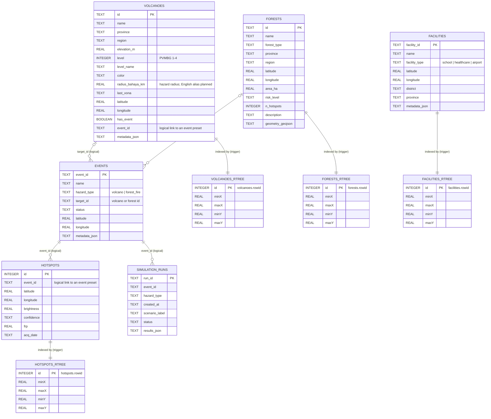

# ERD: Standbai Backend Data Model

**Engine:** SQLite with the built-in **R*Tree** module for spatial indexes.
- **File:** `data/udarasiaga.db`, to be renamed `data/standbai.db` in ticket BE-03a.
- **Schema source:** `app/db/schema.py`.
- **Connection:** `app/db/session.py` (WAL journal, `synchronous=NORMAL`, 64 MB page cache, `foreign_keys=ON`).

Counts below were read directly from the database file (read-only) on **2026-10-10**.

> **Relationships are logical, not enforced.** No table declares a `FOREIGN KEY`; the links below are by convention (matching ids). Simulation **events** and **runs** live mostly in files (`data/events/<event_id>/meta.json`, `data/runs/<run_id>.json`), not in the `events` and `simulation_runs` tables.

---

## 1. Current schema (on `main`)



### 1.1 Tables, contents and counts
| Table | Rows (2026-10-10) | Contents | Source |
|---|---|---|---|
| `volcanoes` | 70 | Active volcanoes with PVMBG alert level, hazard radius, last VONA, linked event preset | PVMBG / MAGMA Indonesia, curated in `data/layers/volcanoes_indonesia.geojson` |
| `forests` | 36 | Forest and peatland areas with polygon (`geometry_geojson`), risk level, hotspot count, description | Curated from protected-area and peatland references; `data/layers/forests_indonesia.json`, `forest_boundaries.geojson` |
| `facilities` | 992 | 583 schools, 330 health facilities, 79 airports | `data/layers/facilities_indonesia.json` (OpenStreetMap and official lists) |
| `hotspots` | 4,248 | NASA FIRMS fire detections grouped by event preset (`event_id`) | `data/events/*/hotspots.csv` |
| `events` | 0 | Unused today; event presets are read from `data/events/<id>/meta.json` | - |
| `simulation_runs` | 0 | Unused today; runs are written to `data/runs/<run_id>.json` | - |

### 1.2 Indexes
- **B-tree:**
  - `idx_volcanoes_level`, `idx_volcanoes_region`;
  - `idx_forests_province`, `idx_forests_region`;
  - `idx_facilities_type`, `idx_facilities_district`, `idx_facilities_province`;
  - `idx_hotspots_event`, `idx_hotspots_date`.
- **R*Tree virtual tables** (`<table>_rtree`, columns `id, minX, maxX, minY, maxY`; X = longitude, Y = latitude):
  - `id` is the base table's `rowid`;
  - points are stored as zero-size boxes.

### 1.3 Triggers (keep R*Tree in sync)
| Base table | Triggers |
|---|---|
| `facilities` | `trg_facilities_insert`, `trg_facilities_delete`, `trg_facilities_update` |
| `volcanoes` | `trg_volcanoes_insert`, `trg_volcanoes_delete`, `trg_volcanoes_update` |
| `forests` | `trg_forests_insert`, `trg_forests_delete`, `trg_forests_update` |
| `hotspots` | `trg_hotspots_insert`, `trg_hotspots_delete` (no update trigger) |

**Bounding-box query pattern** (used by the repositories in `app/db/repositories/`):

```sql
SELECT f.* FROM facilities f
JOIN facilities_rtree r ON r.id = f.rowid
WHERE r.minX <= :east AND r.maxX >= :west AND r.minY <= :north AND r.maxY >= :south
LIMIT :limit;
```

### 1.4 File-based data (not in the DB)
| Path | Contents |
|---|---|
| `data/events/<event_id>/meta.json` | Event preset: hazard, name, time window, bbox, `members_source`, data status, source URLs |
| `data/events/<event_id>/weather_ensemble.json` | Cached ensemble weather for the event |
| `data/events/<event_id>/hotspots.csv` | FIRMS detections (fire events) |
| `data/events/<event_id>/vona.json`, `validation.json`, `reported_impact.geojson` | Volcano observations and validation data |
| `data/layers/*.geojson`, `*.json` | Coastline, volcanoes, forests, facilities |
| `data/runs/<run_id>.json` | Simulation outputs (git-ignored; lost on Cloud Run redeploy) |
| `config/assumptions.yaml`, `config/hazards.yaml` | Constants with status and source; hazard parameters |

---

## 2. Planned tables (from `PRD.md`)

```mermaid
erDiagram
    ALERT_SUBSCRIPTIONS {
        INTEGER id PK
        TEXT chat_id "Telegram chat id"
        TEXT city_id "cities.json id"
        TEXT created_utc
        TEXT last_level "low|medium|high, for change detection"
        TEXT last_alert_utc
    }
    AIR_QUALITY_CACHE {
        TEXT city_id PK
        TEXT fetched_utc PK
        TEXT series_json "3-hourly PM2.5, PM10, dust, -72..+72 h"
        TEXT source
    }
    OUTLOOK_CACHE {
        TEXT city_id PK
        TEXT generated_utc
        TEXT outlook_json "smoke_3d, dry_2w, fire_1m, volcano, reasons, confidence"
        TEXT engine "heuristic_v0 | outlook_v1"
    }
    HISTORICAL_EVENTS {
        TEXT id PK "merapi-2010, haze-2019"
        TEXT name
        TEXT hazard "volcano | fire"
        TEXT start_utc
        TEXT end_utc
        REAL latitude
        REAL longitude
        TEXT bbox
        TEXT sources_json
    }
    NEWS_ARTICLES {
        INTEGER id PK
        TEXT event_id
        TEXT title
        TEXT publisher
        TEXT published_utc
        TEXT url "unique; link-out only, no article text"
        TEXT fetched_via "google_news_rss | wikipedia | manual"
    }
    EVENT_LESSONS {
        INTEGER id PK
        TEXT event_id
        TEXT kind "masks|water|medicine|evacuation|school_closure|shelter|number"
        TEXT text
        TEXT cites_json "news_articles ids"
        TEXT reviewed_by
    }
    DATA_SOURCES {
        TEXT id PK "firms, cams, open_meteo, pvmbg, ..."
        TEXT url
        TEXT licence
        TEXT attribution
        TEXT last_refresh_utc
        TEXT last_status
    }
    INGEST_JOBS {
        INTEGER id PK
        TEXT job "refresh-fires | refresh-air | fetch-news"
        TEXT started_utc
        TEXT finished_utc
        TEXT status
        TEXT message
    }
    CHAT_EVENTS {
        INTEGER id PK
        TEXT created_utc
        TEXT channel "web | telegram"
        TEXT intent
        TEXT engine "featherless | gemini | template | rules"
        INTEGER latency_ms
        TEXT tools "comma list; no message text stored"
    }

    HISTORICAL_EVENTS ||--o{ NEWS_ARTICLES : "event_id"
    HISTORICAL_EVENTS ||--o{ EVENT_LESSONS : "event_id"
    DATA_SOURCES ||--o{ INGEST_JOBS : "job source"
```



| Table | Priority | Owner | Notes |
|---|---|---|---|
| `alert_subscriptions` | P0 | Hikari | Unique on (`chat_id`, `city_id`). `/unsubscribe` deletes rows. Only personal data: the Telegram `chat_id`. |
| `air_quality_cache`, `outlook_cache` | P0 (optional) | Hikari | An in-memory cache is enough on one instance. Persist only if cold starts hurt. |
| `historical_events`, `news_articles`, `event_lessons` | P1 | Arya | Seeds start as JSON in `data/history/`; load into tables later if needed |
| `data_sources`, `ingest_jobs` | P1 | Hikari | Feed `/health` freshness and the `/why` page |
| `chat_events` | P1 | Hikari | Anonymous usage metrics only |
| `simulation_runs` (existing) | P2 | Arya | Store run metadata here instead of only JSON files |

**DDL sketch** for the P0 table:

```sql
CREATE TABLE IF NOT EXISTS alert_subscriptions (
    id INTEGER PRIMARY KEY AUTOINCREMENT,
    chat_id TEXT NOT NULL,
    city_id TEXT NOT NULL,
    created_utc TEXT NOT NULL,
    last_level TEXT,
    last_alert_utc TEXT,
    UNIQUE (chat_id, city_id)
);
CREATE INDEX IF NOT EXISTS idx_alert_subscriptions_city ON alert_subscriptions(city_id);
```

---

## 3. Migrations planned in the PRD

| Change | How | Ticket |
|---|---|---|
| Rename the DB file to `data/standbai.db` | `git mv data/udarasiaga.db data/standbai.db`; update `DB_PATH` in `app/db/session.py` and the scripts | BE-03a |
| English hazard radius | Add `hazard_radius_km REAL` and copy from `radius_bahaya_km` (`ALTER TABLE volcanoes ADD COLUMN …; UPDATE volcanoes SET hazard_radius_km = radius_bahaya_km;`), or alias in `VolcanoRepository`. Keep the old column until the frontend switches. | BE-03b |
| Add `alert_subscriptions` | Add the DDL above to `app/db/schema.py` (`CREATE TABLE IF NOT EXISTS`, so it's safe on existing files) | BE-11 |
| English text in `forests.description` and other prose | Update the JSON sources in `data/layers/`, then re-seed or run `UPDATE` statements | BE-03b |

**Cloud Run note:** the database ships inside the container image and the instance disk is ephemeral. Writes such as subscriptions survive only until the next deploy or restart. Fine for the hackathon; use Cloud SQL or Firestore later.
