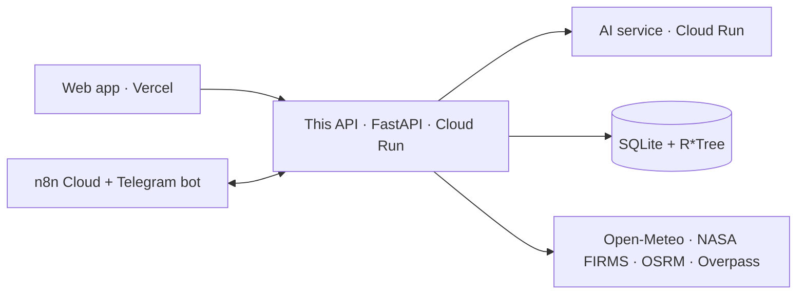

# MEMORY: Standbai Backend API (`BE-FORGEHACK-2026`)

> ## Language rule (read first)
> **Always use English** in this repository: code, comments, docstrings, API values and error messages, OpenAPI tags, docs, commit messages, and every explanation written by an AI assistant. ForgeHacks is an international hackathon judged in English.
> Allowed exceptions: stable data slugs (e.g. `hutan_sebangau`, `karhutla_riau`); proper nouns (places; agencies such as BMKG, PVMBG, BPBD, BNPB); official Indonesian terms carried with an English gloss (e.g. ISPU `official_name_id: "Tidak Sehat"` next to `code: "unhealthy"`; "Level III, Siaga (Watch)").

Shared memory for people and coding agents working on the backend. Keep **Progress** and the **Decision log** current. Tasks live in [`PRD.md`](PRD.md); the data model is in [`ERD.md`](ERD.md); datasets are in [`docs/DATASETS.md`](docs/DATASETS.md).

---

## 1. Competition essentials
- **ForgeHacks Online 2026**, track **AI + Climate**: "Build an AI-powered solution that helps people understand environmental changes, prepare for climate impacts, use resources wisely, or create resilient systems."
- **Submission locks Sat Oct 10, 12:00 PM ET = 23:00 WIB.** Feature freeze 18:00 WIB.
- **Judges test the live link.** The API must be deployed, CORS-correct and honest about what is real versus example data.
- **Judging:** impact · technical & AI use ("AI does useful work; explain how and why") · innovation · execution & completeness · presentation, 20% each.
- **Rules:** build during the event; use AI honestly; "a half-working project is okay; overstating it isn't."

## 2. Product
- **Standbai** tells families in Indonesia where wildfire smoke and volcanic ash will go, and what to prepare before it arrives.
- **This repo is the single public API** for:
  - the web app (`FE-FORGEHACK-2026`);
  - n8n Cloud, which runs the scheduled jobs and the **Telegram bot** (`/subscribe`, `/status`, daily digest, instant alerts).
- **What it owns:**
  - the Lagrangian dispersion engine (ash and smoke, ensemble probability tiers);
  - impact analysis, the spatial database, and city-centred endpoints;
  - the preparedness calculator, subscriptions, and the optional `/chat` orchestration.
- **Honesty rules:** see [`AGENTS.md`](AGENTS.md).
  - ranges, not single impact numbers;
  - labelled assumptions and scenarios;
  - the `is_example` flag;
  - the disclaimer "Not an official warning. Follow BMKG, PVMBG and your local BPBD."

## 3. Architecture

- Local ports: BE 8000, AI 8001, FE 5173.

## 4. People
| Person | Role in this repo |
|---|---|
| **Hikari Reiziq** | API and platform: deploy (BE + AI), config, city endpoints, preparedness, alerts, n8n/Telegram, `/chat` |
| **Arya Bisma** | Engine and data: simulation engine, fires, volcanoes, map frames, timeline, history data |
| Ziddan Habibie | Frontend consumer |
| Arkan Zahir | AI service (upstream for chat, advisory, outlook) |

## 5. Repository map
| Path | Contents |
|---|---|
| `app/main.py` | FastAPI app, CORS, routers; seeds the DB on first start |
| `app/api/` | Routers: `health`, `events`, `simulate` (runs, tiers, impact, location cards), `lapis2` (analysis), `lapis3` (trust: validation, limits, sources, export, advisory, evacuation, lahar), `layers`, `attributions` |
| `app/engine/` | Particle engine: `simulator`, `particles` (RK2 advection, settling), `volcano` (eruption source), `fire` (FRP to smoke), `scavenging` (rain), `grid`, `aggregation` (tiers), `landmask` |
| `app/impact/` | Exposure, advisory (deterministic + Gemini), export, routing (OSRM), validation, fire/volcano features |
| `app/ingest/` | FIRMS, Open-Meteo, Overpass, population clients |
| `app/db/` | SQLite connection (WAL), DDL with R*Tree indexes and triggers, repositories |
| `config/` | `assumptions.yaml` (every constant with its status and source), `hazards.yaml` |
| `data/` | `udarasiaga.db` (to be renamed `standbai.db`), `events/<id>/` presets, `layers/` GeoJSON, `runs/` outputs (git-ignored) |
| `scripts/` | Data generators, DB seeding, source verification, live API validation, GitHub project-board automation (not used by the app) |
| `tests/` | `test_physics`, `test_integrity`, `test_database`, `test_lapis2`, `test_lapis3` |
| `docs/` | `SPEC.md` (engine spec), `API_CONTRACT.md`, `SOURCES.md`, `DATASETS.md`, `DATABASE_ARCHITECTURE.md` (superseded by `ERD.md`), `fixtures/` |

## 6. Progress (verified on `main` `068b8b1`, 2026-10-10)
- **Working, in code:**
  - 31 routes covering simulation runs (volcano and fire), probability tiers per hour, impacts as ranges, facility decision cards, fire-cluster ranking, "extinguish a hotspot", carbon, rain effect, scenario compare, sensitivity, advice, severity, arrival, validation, limits, sources, export, emergency advisory, evacuation route, lahar warning, map layers.
  - DB: 70 volcanoes, 36 forest areas, 992 facilities (583 schools, 330 health, 79 airports), 4,248 FIRMS hotspots.
- **Not ready** (tickets in `PRD.md`):
  - offline by default and `.env` not loaded (BE-02);
  - no Dockerfile or deploy (BE-01);
  - Gemini called directly with shut-down model ids and the key in the URL (BE-04);
  - Indonesian strings and the old product name in responses (BE-03a/b);
  - no city endpoints, preparedness, alerts or `/chat` yet (BE-05…BE-14).
- **Tests:** 40 passed (`pytest -q`, offline, Python 3.14, 2026-10-10).

## 7. Conventions
- **Times:** UTC ISO 8601.
- **API JSON:** snake_case. New responses carry `generated_at`, `source`, `is_example`.
- **ISPU:** codes `good | moderate | unhealthy | very_unhealthy | hazardous` plus `official_name_id`. Hourly values are labelled "indicative".
- **Constants:** every constant lives in `config/assumptions.yaml` with `status` (`sourced`, `sourced_range`, `sourced_secondary`, `modeling_choice`, `to_verify`, `assumption_placeholder`) and `source`.
- **Secrets:** only in `.env` locally and Cloud Run secrets in production. Never in code, logs, responses or the frontend.
- **Job and alert endpoints** require `X-Job-Token`; AI calls send `X-Internal-Token`.
- **Gates:** `pytest -q` and `ruff check .` before every push.
- **Git:** Conventional Commits in English (`feat(area): add outlook endpoint`); branches `feat/…`, `fix/…`, `docs/…`.

## 8. Decision log
| Date | Decision | Why |
|---|---|---|
| 2026-10-09 | Product name **Standbai**; English API and docs | International judging |
| 2026-10-09 | Deploy on Google Cloud Run (`asia-southeast2`), 1 instance, CPU always allocated | Background simulations and file-based runs need one warm instance |
| 2026-10-10 | Backend is the single public API (BFF) for web, Telegram/n8n and chat | One contract, one place for keys and validation |
| 2026-10-10 | City-centred endpoints follow the FE prototype's data needs; contracts shared in both PRDs | Lets FE and BE build in parallel |
| 2026-10-10 | Air quality from CAMS via the Open-Meteo Air Quality API (PM2.5, PM10, dust) | Free, no key, forecast + recent past |
| 2026-10-10 | Outlook heuristic v0 today; ML outlook from the AI service when it beats its baseline | Honest and explainable now, better later |
| 2026-10-10 | n8n for scheduled jobs and the Telegram bot; BE stores only `chat_id` + city | Uses a sponsor perk; minimal personal data |
| 2026-10-10 | All LLM calls move behind the AI service (Featherless primary, Gemini fallback) | One gateway, no LLM keys in BE |
| 2026-10-10 | Additive API changes only (`hazard_radius_km` next to `radius_bahaya_km`) | Don't break the existing dashboard on deadline day |
| 2026-10-10 | No Kafka, Spark or MinIO today; scale-up path: GCS, Pub/Sub, BigQuery | Data volume fits SQLite/DuckDB |

## 9. Links
- Frontend: https://github.com/ITHACKITS/FE-FORGEHACK-2026 · AI: https://github.com/ITHACKITS/AI-FORGEHACK-2026
- Devpost: https://forgehacks-2026.devpost.com
- Live API: *add the Cloud Run URL after BE-01.* · Telegram bot: *add after BE-11.*
