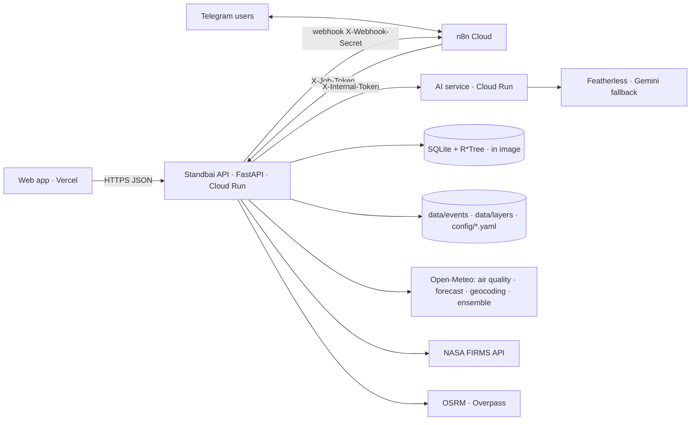
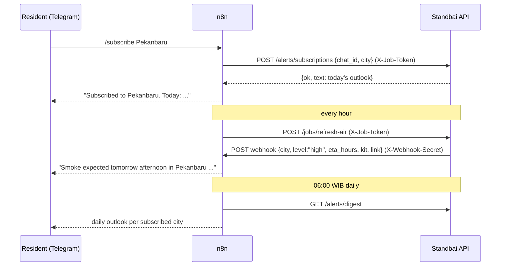

# PRD: Standbai Backend API (`BE-FORGEHACK-2026`)

| | |
|---|---|
| **Owners** | **Hikari Reiziq**: API, platform, deploy, n8n/Telegram · **Arya Bisma**: simulation engine, fires, volcanoes, map frames, history data |
| **Consumers** | Ziddan Habibie (web app, `FE-FORGEHACK-2026`) · n8n Cloud (jobs, Telegram bot) |
| **Upstream** | Arkan Zahir (AI service, `AI-FORGEHACK-2026`) |
| **Event** | ForgeHacks Online 2026, AI + Climate track |
| **Deadline** | Feature freeze **Sat Oct 10, 18:00 WIB**; submission locks **23:00 WIB** (12:00 PM ET) |
| **Status** | Ready to execute. Read §1–6 once, then work the [task board](#9-task-board). |

> **Language rule.** Everything in this repo is English: code, comments, API values, docs, commits. See [`MEMORY.md`](MEMORY.md). Data model: [`ERD.md`](ERD.md). Datasets: [`docs/DATASETS.md`](docs/DATASETS.md).

---

## 1. Problem Statement

The backend already contains a strong scientific core:
- a Lagrangian particle engine for volcanic ash and wildfire smoke, with ensemble probability tiers;
- impact analysis for schools, health facilities and airports;
- evacuation routing;
- a spatial SQLite database.

But the web app and the residents it serves can't use it yet:

- **Wrong shape for residents.** Its 31 endpoints are built around *simulation runs* for experts. The new web app (the prototype in `FE-FORGEHACK-2026/docs/design/reference-prototype.html`) needs *city-centred* answers: "air right now", "the next 3 days", "an outlook for 2 weeks and a month", "what to prepare". None of these exist.
- **Not deployable.** Offline mode defaults to on (`UDARASIAGA_OFFLINE="1"`), `.env` is never loaded, CORS is `*`, there's no Dockerfile, and the old product name and Indonesian strings leak into API responses.
- **Broken Gemini calls.** The backend calls Gemini directly with shut-down model ids (`gemini-1.5-*`, `gemini-2.0-flash`) and puts the API key in the URL query string.
- **No path to people's phones.** Nothing pushes a warning to a resident before the smoke arrives.

## 2. Solution

Make the backend the **single public API** (a backend-for-frontend) for the web app, the Telegram bot and n8n:

1. **New city-centred endpoints.** They answer the prototype's needs from real data: CAMS air-quality forecasts via Open-Meteo, NASA FIRMS hotspots, PVMBG volcano levels, Open-Meteo weather, the Standbai engine, and the AI service's outlook.
2. **Deterministic preparedness maths.** The web app, the Telegram bot and the chat all quote the same numbers.
3. **Job endpoints for n8n.** n8n refreshes FIRMS and air-quality caches on a schedule.
4. **Telegram subscriptions and alerts.** n8n runs the bot and BE stores subscriptions and builds messages.
5. **Optional `/chat`.** BE orchestrates tools and links, and the AI service does the language work.
6. **Deployable on Cloud Run** with environment-based config, a CORS allow-list and secrets out of the code.

The existing simulation endpoints stay unchanged in shape, so the `/simulate` view keeps working.

## 3. User Stories

1. As a resident, I want to pick my city and see the current PM2.5, its ISPU category and one piece of advice, so that I know what to do now.
2. As a resident, I want hourly PM2.5, PM10 and dust from three days ago to three days ahead, so that I can see the trend.
3. As a resident, I want a Low/Medium/High outlook for the next 3 days, 2 weeks and month, plus my nearest volcano, so that I can prepare early.
4. As a resident, I want to know which signals produced the outlook (hotspots nearby, wind, rain, current PM2.5) with source links, so that I can trust it.
5. As a parent, I want mask, water and medicine quantities for my household and the number of bad-air days, so that I buy the right amounts.
6. As a resident, I want to subscribe to my city on Telegram, so that I get a daily outlook and an alert when it turns High.
7. As a resident, I want to unsubscribe at any time, so that I stay in control.
8. As a curious user, I want fire hotspots for the last 7 days and volcano alert levels, so that the map shows real events.
9. As a user of the map, I want a PM2.5 field for Indonesia from 7 days ago to 3 days ahead, so that I can watch smoke move.
10. As an emergency volunteer, I want the existing plume simulation, tiers, impacts and evacuation routes to keep working, so that the expert view isn't broken.
11. As a user, I optionally want to ask a question in the web chat or on Telegram and get an answer with links into the app.
12. As a user, I want to explore past events (Merapi 2010, the 2019 haze) with hotspots and news, so that I learn what happened and what people needed.
13. As the frontend developer, I want stable JSON contracts with examples and an `is_example` flag, so that I can build in parallel and never show fake data unlabelled.
14. As n8n, I want token-protected job endpoints, so that only our automation can trigger refreshes.
15. As a judge, I want `/docs` (OpenAPI) and a `/health` that names the data sources and models, so that I can test the API.
16. As the team, I want the backend to keep working, with clear `available:false` reasons, when an upstream API is down, so that the demo never crashes.
17. As the team, I want no API key in code, logs, responses or the frontend, so that nothing leaks.
18. As a judge, I want every impact number shown as a range and every assumption labelled, so that the science is honest.

## 4. Implementation Decisions

### 4.1 Architecture



**Service boundaries:**
- BE owns data access, the simulation engine (in-process), deterministic calculators, link building, rate limiting and subscriptions.
- The AI service owns everything LLM- and ML-related: chat interpret/respond, the outlook model, history summaries, the advisory text and the fire classifier.
- BE never exposes the AI service directly; the web app talks to BE only.

**New modules** (suggested layout):

| Path | Owner | Purpose |
|---|---|---|
| `app/api/cities.py` | Hikari | `/cities` |
| `app/api/area.py` | Hikari | `/area/now`, `/area/series`, `/area/outlook` |
| `app/api/preparedness.py` | Hikari | `POST /preparedness` |
| `app/api/alerts.py` | Hikari | subscriptions, digest, alert webhook trigger |
| `app/api/jobs.py` | Hikari (refresh-air) / Arya (refresh-fires, fetch-news) | n8n job endpoints |
| `app/api/chat.py` | Hikari | `/chat` (P1) |
| `app/api/hazards.py` | Arya | `/fires`, `/volcanoes`, `/events/timeline` |
| `app/api/mapframes.py` | Arya | `/map/frames/meta`, `/map/frames.bin` (P1) |
| `app/api/history.py` | Arya | `/history/*` (P1) |
| `app/services/airquality.py` | Hikari | Open-Meteo Air Quality client and cache |
| `app/services/weather.py` | Hikari | Open-Meteo forecast and archive (wind, rain) |
| `app/services/outlook.py` | Hikari | heuristic outlook v0; calls AI outlook when available |
| `app/services/ai_client.py` | Hikari | HTTP client for the AI service (timeouts, fallback) |
| `app/core/cache.py` | Hikari | small in-memory TTL cache |
| `data/cities.json` | Hikari | the 29 cities (§4.4) |

### 4.2 Configuration

The code currently reads only `UDARASIAGA_OFFLINE` (default `"1"`), `FIRMS_MAP_KEY`, `OPENAQ_API_KEY` and `GEMINI_API_KEY`, and never loads `.env`.

**Changes:**
- Call `load_dotenv()` at the top of `app/core/config.py` and add `python-dotenv` to `requirements.txt`.
- Rename the offline flag to `STANDBAI_OFFLINE`, accepting `UDARASIAGA_OFFLINE` as a fallback for one release.
- **Default it to `"0"` in production.**

| Variable | Required | Default | Purpose |
|---|---|---|---|
| `STANDBAI_OFFLINE` | no | `0` | `1` blocks all outbound HTTP (tests, demos without internet) |
| `FIRMS_MAP_KEY` | yes (prod) | - | NASA FIRMS area API |
| `OPENAQ_API_KEY` | no | - | P2 station validation |
| `AI_SERVICE_URL` | yes (prod) | `http://localhost:8001` | AI service base URL |
| `AI_INTERNAL_TOKEN` | yes (prod) | - | sent as `X-Internal-Token` to the AI service |
| `JOB_TOKEN` | yes (prod) | - | required in `X-Job-Token` on `/jobs/*`, `/alerts/digest`, `/alerts/subscriptions` |
| `N8N_ALERT_WEBHOOK_URL` | P1 | - | n8n Webhook node URL for instant alerts |
| `N8N_WEBHOOK_SECRET` | P1 | - | sent as `X-Webhook-Secret` |
| `CORS_ORIGINS` | yes (prod) | `http://localhost:5173` | comma list, e.g. the Vercel domain |
| `PUBLIC_APP_URL` | yes (prod) | `http://localhost:5173` | base for links in Telegram and chat replies |

`GEMINI_API_KEY` is **removed from BE** once BE-04 routes the advisory through the AI service.

### 4.3 API conventions

- **Times:** JSON with UTC ISO 8601.
- **Every new response carries** `generated_at`, `source` and `is_example` (`true` only when serving built-in fallback data).
- **ISPU categories:** codes `good | moderate | unhealthy | very_unhealthy | hazardous`, with `index` 0–4 and `official_name_id` ("Baik", "Sedang", "Tidak Sehat", "Sangat Tidak Sehat", "Berbahaya").
  - PM2.5 breakpoints come from `config/assumptions.yaml` (15.5 / 55.4 / 150.4 / 250.4).
  - Category values on hourly data are labelled `"basis": "indicative, hourly PM2.5"`, because official ISPU uses a 24 h average.
- **Outlook levels:** `low | medium | high`.
- **Errors:** `{ "detail": "...", "available": false, "reason": "..." }`. Upstream failures never 500 the city endpoints; they return the last cached value with `stale: true`, or `available:false`.
- **Additive changes only on existing endpoints:**
  - add `hazard_radius_km` next to `radius_bahaya_km`;
  - add the English ISPU `code` next to the old keys;
  - change `scenario_label` to "hypothetical scenario".
- **OpenAPI tags in English:** `analysis` replaces `lapis2`, `trust` replaces "Lapis 3: Bukti Kepercayaan". Module file renames are optional.

### 4.4 City list (`data/cities.json`, from the prototype)

`id` is the lower-case slug (`bandar-lampung`, `palangka-raya`). `dry` is the prototype's example dryness value and is **not** used once the real rain signal (BE-07) is live.

| City | lat | lon | | City | lat | lon |
|---|---|---|---|---|---|---|
| Banda Aceh | 5.55 | 95.32 | | Mataram | -8.58 | 116.12 |
| Medan | 3.59 | 98.67 | | Kupang | -10.17 | 123.60 |
| Pekanbaru | 0.51 | 101.45 | | Maumere | -8.62 | 122.21 |
| Padang | -0.95 | 100.36 | | Pontianak | -0.03 | 109.33 |
| Jambi | -1.61 | 103.61 | | Palangka Raya | -2.21 | 113.92 |
| Palembang | -2.99 | 104.75 | | Banjarmasin | -3.32 | 114.59 |
| Bandar Lampung | -5.43 | 105.26 | | Samarinda | -0.50 | 117.15 |
| Jakarta | -6.20 | 106.85 | | Makassar | -5.14 | 119.43 |
| Bandung | -6.91 | 107.61 | | Palu | -0.90 | 119.87 |
| Semarang | -6.99 | 110.42 | | Manado | 1.49 | 124.84 |
| Yogyakarta | -7.80 | 110.37 | | Ternate | 0.79 | 127.38 |
| Surabaya | -7.25 | 112.75 | | Ambon | -3.70 | 128.18 |
| Malang | -7.98 | 112.63 | | Sorong | -0.88 | 131.25 |
| Denpasar | -8.65 | 115.22 | | Jayapura | -2.53 | 140.70 |
| | | | | Merauke | -8.50 | 140.40 |

### 4.5 Endpoint contracts

The JSON examples for the endpoints the web app uses are in the FE PRD §5 (`FE-FORGEHACK-2026/PRD.md`). **That section is the shared contract**: change it in both PRDs or not at all. This section adds how to compute each one and the BE-only endpoints.

| Endpoint | How it is computed | Priority · Owner |
|---|---|---|
| `GET /cities` | read `data/cities.json` | P0 · Hikari |
| `GET /area/now?city=` | first hour ≤ now from the cached air-quality series; wind from the Open-Meteo forecast (`wind_speed_10m`, `wind_direction_10m`); advice from the ISPU index | P0 · Hikari |
| `GET /area/series?city=&from=-72&to=72` | Open-Meteo **Air Quality API** (CAMS global) `hourly=pm2_5,pm10,dust` with `past_days=3&forecast_days=4`, resampled to 3-hourly; `kind` = recorded for t ≤ now, else forecast; `days[]` = daily max of the next 3 days | P0 · Hikari |
| `GET /area/outlook?city=` | **heuristic v0** (below); P1 replaces `fire_1m`/`dry_2w` with the AI outlook (`AI /api/v1/outlook/point`) | P0 · Hikari |
| `POST /preparedness` | masks = people × max(bad_days, 1); water = 3 L × people × bad_days; medicine days = bad_days + 2 (only if bad_days > 0 or sensitive); room 1 if bad_days > 0; bag 1. Constants live in `config/assumptions.yaml` with status labels | P0 · Hikari |
| `GET /fires?hours=168` | FIRMS area API `VIIRS_SNPP_NRT` (+ `VIIRS_NOAA20_NRT`) over bbox `94,-11,142,6`; **max `DAY_RANGE` is 5**, so 7 days = 2 calls (`…/5` and `…/2/<date>`); dedupe; cache 3 h; offline fallback = hotspots table | P0 · Arya |
| `GET /volcanoes` | `volcanoes` table: `id, name, lat, lon, level, level_name` (English gloss), `hazard_radius_km`, `last_vona` | P0 · Arya |
| `GET /events/timeline?days=7` | fire clusters (DBSCAN on `/fires`, first-seen time) + volcano events from `data/events/*/meta.json` within the window | P1 · Arya |
| `GET /map/frames/meta`, `/map/frames.bin` | 0.2° grid 235×100, −168…+72 h step 3; past and forecast PM2.5 from CAMS at grid points (batched multi-coordinate Open-Meteo calls, cached for 3 h) + engine plume concentration for active runs; uint8 with scale 1.5 µg/m³ per step; gzip | P1 · Arya |
| `POST /alerts/subscriptions` | body `{chat_id, city}`; validate the city; upsert into `alert_subscriptions`; return today's outlook text. Requires `X-Job-Token` (called by n8n only) | P0 · Hikari |
| `DELETE /alerts/subscriptions` | body `{chat_id, city?}`; delete one or all | P0 · Hikari |
| `GET /alerts/digest` | for each subscribed city: `{city, chat_ids[], text, link}`, where text = outlook 3 d / 2 w / month + kit summary for 4 people; requires `X-Job-Token` | P0 · Hikari |
| `POST /jobs/refresh-fires` | refresh the FIRMS cache | P0 · Arya |
| `POST /jobs/refresh-air` | refresh the city air-quality cache (one multi-coordinate call for all 29 cities), recompute outlooks, and **POST to `N8N_ALERT_WEBHOOK_URL`** for any subscribed city whose `smoke_3d.level` became `high` since the last run (P1) | P0 (alerts P1) · Hikari |
| `POST /jobs/fetch-news` | history news fetch (§4.8) | P1 · Arya |
| `POST /chat` | §4.7 | P1 optional · Hikari |
| `GET /history/*` | §4.8 | P1 · Arya |
| `GET /health` | add `engine`, `llm` (from AI `/health`), `data_sources` with last refresh times, `offline` | P0 · Hikari |

### 4.6 Outlook heuristic v0 (P0, honest and explainable)

| Field | Rule | `reasons[]` entry |
|---|---|---|
| `smoke_3d` | level from the max forecast PM2.5 in the next 72 h: ≤55.4 low, ≤150.4 medium, else high; `arrival_utc` = first forecast hour reaching the peak category (≥ Unhealthy) | `pm25_now`, `wind` |
| `dry_2w` | rain over the last 7 days (archive) + next 16 days (forecast) from Open-Meteo `precipitation_sum`: >40 mm low, 10–40 mm medium, <10 mm high | `rain_7d_mm` |
| `fire_1m` | FIRMS hotspots within 300 km in the last 7 days weighted by distance: <5 low, 5–30 medium, >30 high; P1 adds the AI monthly climatology/outlook | `hotspots_300km` |
| `volcano` | nearest volcano within 250 km with level ≥ 2 from the `volcanoes` table; `ash_toward_deg` = the current 850 hPa wind direction + 180 (from Open-Meteo) | - |
| `bad_days` | number of the next 3 days whose max PM2.5 > 55.4 (normal) or > 35 (sensitive) | - |
| `confidence` | `basis:"example"` with the prototype's 82/68/54 % until Arkan's backtest metrics exist; then `basis:"backtest"` | - |

- `engine` is `"heuristic_v0"`, and the thresholds live in `config/assumptions.yaml` as `modeling_choice`.
- Wind in `reasons[]` sets `toward_city: true` when the angle between the hotspot-weighted bearing and the wind's downwind bearing is under 45°.

### 4.7 `/chat` orchestration (P1, optional; serves web and Telegram)

1. **Validate:** ≤12 messages, ≤1,000 characters each; rate limit 20 requests/min/IP (web) or per `chat_id` (Telegram).
2. **Interpret:** call `AI POST /api/v1/chat/interpret` with the messages. It returns `{intent, place, hazard, horizon_hours, household_size, sensitive, event_hint, needs_clarification}`.
3. **Run up to 4 tools in-process, each with a 5 s timeout:**
   - geocode: Open-Meteo Geocoding with `countryCode=ID`, nearest of the 29 cities;
   - `area_outlook`;
   - `area_now`;
   - `preparedness`;
   - `history_lookup`.
4. **Build `actions[]` only from the allow-listed templates:**
   - `/dashboard?city={id}`
   - `/map?t={h}`
   - `/ready?city={id}`
   - `/why?city={id}`
   - `/simulate?event={event_id}&hours=72&autorun=1`
   - `/history/{id}`
5. **Respond:** call `AI POST /api/v1/chat/respond` with `{messages, facts, actions}`.
   - BE checks that every number in the reply exists in `facts`; otherwise it uses the template reply.
   - If the AI service is down: rule-based intent (keywords) plus the template reply, with `engine:"template"`.
6. **Channel formatting:** with `channel:"telegram"`, links become absolute (`PUBLIC_APP_URL` + path) for n8n's inline buttons.
7. **Logging:** intent, tool names, latencies and engine only; never the message text.

**Horizon rule:**
- ≤72 h: dashboard/map/simulate links.
- 3–30 days: outlook (`dry_2w`, `fire_1m`) plus a "prepare now" kit.
- More than 30 days: explain that Standbai doesn't forecast that far.

### 4.8 History + news (P1, after P0 is live)

- **Seed files** (offline-safe, committed):
  - `data/history/events.json`: id, name, hazard, dates, centre and bbox, sources.
  - `data/history/news/<id>.json`: at most 30 items, each `{title, publisher, published_utc, url}`.
  - `data/history/summaries/<id>.json`: produced by Arkan, reviewed by a person.
- **Events:**
  - `merapi-2010` (Mount Merapi, Oct–Nov 2010);
  - `haze-2019` (Sumatra and Kalimantan haze, Sep–Oct 2019).
  - Dates and numbers are checked against Smithsonian GVP, Wikipedia and BNPB before they're written.
- **News fetch** (`scripts/history/fetch_news.py`, run by `POST /jobs/fetch-news`):
  - Google News RSS search `https://news.google.com/rss/search?q=<query>+after:<YYYY-MM-DD>+before:<YYYY-MM-DD>&hl=en-ID&gl=ID&ceid=ID:en`, plus the Wikipedia REST summary;
  - store **only** title, publisher, date and URL (link-out; never article text);
  - dedupe by URL;
  - unofficial feed, so failures are tolerated.
- **Hotspots:** `GET /history/events/{id}/hotspots?date=` serves FIRMS archive points (MODIS for 2010, VIIRS for 2019) from a pre-downloaded CSV per event.
- **Endpoints:**
  - `GET /history/events`
  - `GET /history/events/{id}`
  - `GET /history/events/{id}/news`
  - `GET /history/events/{id}/hotspots?date=`
  - `GET /history/analogs?city=`: past events near the city, for the "last time" panel.

### 4.9 Telegram + n8n (owner Hikari)



**n8n workflows** (export each as JSON into `n8n/` and commit):
1. `standbai-refresh-fires`: Schedule (every 3 h) → HTTP `POST /jobs/refresh-fires`.
2. `standbai-refresh-air`: Schedule (hourly) → HTTP `POST /jobs/refresh-air`.
3. `standbai-telegram-bot`: Telegram Trigger, then a Switch on the command:
   - `/start`: send the welcome, the disclaimer and the command list;
   - `/subscribe <city>` and `/start <city_id>` (the web deep link): call `POST /alerts/subscriptions`;
   - `/unsubscribe`: call `DELETE /alerts/subscriptions`;
   - `/status <city>`: call `GET /area/outlook`, format it, and add a URL button to the dashboard;
   - free text: call `POST /chat` (P1) or reply with the command list.
4. `standbai-daily-digest`: Schedule (06:00 Asia/Jakarta) → `GET /alerts/digest` → loop → Telegram send. Keep under 25 messages per second.
5. `standbai-alert-webhook` (P1): Webhook node (check the `X-Webhook-Secret` header) → Telegram send to the city's chat ids (BE includes them in the payload).

**Bot copy** (English; the disclaimer is always included):

> Standbai Bot sends smoke and ash outlooks for Indonesian cities.
> Commands: /subscribe <city> · /status <city> · /unsubscribe
> Not an official warning. Follow BMKG, PVMBG and your local BPBD.

**Privacy:** only `chat_id`, `city` and `created_utc` are stored. `/unsubscribe` deletes them, and there is no other personal data.

### 4.10 Deployment (Cloud Run)

**`Dockerfile`** (BE-01 creates it):

```dockerfile
FROM python:3.12-slim
WORKDIR /app
ENV PYTHONDONTWRITEBYTECODE=1 PYTHONUNBUFFERED=1
COPY requirements.txt .
RUN pip install --no-cache-dir -r requirements.txt
COPY . .
CMD exec uvicorn app.main:app --host 0.0.0.0 --port ${PORT:-8080}
```

Add a `.dockerignore` with `.git`, `__pycache__`, `.pytest_cache`, `.env` and `data/runs/*.json`.

**Deploy command:**

```bash
gcloud run deploy standbai-api --source . --region asia-southeast2 \
  --cpu 1 --memory 2Gi --no-cpu-throttling --min-instances 1 --max-instances 1 --timeout 300 \
  --allow-unauthenticated \
  --set-env-vars STANDBAI_OFFLINE=0,AI_SERVICE_URL=<ai-url>,CORS_ORIGINS=<vercel-url>,PUBLIC_APP_URL=<vercel-url> \
  --set-secrets FIRMS_MAP_KEY=firms-map-key:latest,AI_INTERNAL_TOKEN=ai-internal-token:latest,JOB_TOKEN=job-token:latest
```

**Why these flags:**
- `--no-cpu-throttling`: simulation runs as a background task after the response.
- `--max-instances 1`: run files and subscriptions live on the instance's disk.
- `--min-instances 1`: no cold start while judges test.
- Subscriptions in SQLite are lost on redeploy. That's acceptable for the hackathon; the P2 fix is Cloud SQL or Firestore.

**Cost:** one always-on 1 vCPU / 2 GiB instance for the judging window costs a few dollars at list price. A new Google Cloud account comes with free credit; billing must be enabled.

**Big-data path (not today):** GCS (S3-compatible object store), Pub/Sub (Kafka role), BigQuery or Dataproc (Spark role). Revisit when the FIRMS and CAMS archives outgrow SQLite/DuckDB on one instance.

### 4.11 Resilience, security and observability

- **Outbound calls:** shared `httpx` client with 10 s timeout, 2 retries with backoff for GET, and a User-Agent `Standbai/1.0 (+https://github.com/ITHACKITS/BE-FORGEHACK-2026)`.
- **Cache:** in-memory TTL cache per key. Air quality: 1 h. Fires: 3 h. Geocoding: 24 h. On upstream failure, serve the stale value with `stale:true`.
- **AI client:**
  - timeout 20 s;
  - after 3 failures in 60 s, skip the AI for 60 s (circuit breaker) and use fallbacks.
- **Input validation:** Pydantic models; `city` must be in the list; `lat` in −11…6 and `lon` in 94…142 for free coordinates.
- **Access control and limits:**
  - CORS allow-list from `CORS_ORIGINS`, with no credentials;
  - job and alert endpoints require tokens;
  - rate limit on `/chat` and `/simulate`.
- **Logging:** structured JSON with a request id. Never log keys, tokens or chat text.

### 4.12 Honesty rules (from `AGENTS.md`, unchanged)

- Impact numbers are ranges `{min, median, max}`.
- Assumptions carry their status.
- Hypothetical scenarios are labelled.
- Results carry the disclaimer: "Not an official warning. Follow BMKG, PVMBG and your local BPBD."
- Example data is flagged with `is_example`.

## 5. Testing Decisions

- **Good tests** check behaviour through the HTTP API with `fastapi.testclient`, with upstreams mocked by fixtures. No live network in `pytest`; `STANDBAI_OFFLINE=1` in tests.
- **Keep the existing suites green:** `tests/test_physics.py`, `test_integrity.py`, `test_database.py`, `test_lapis2.py`, `test_lapis3.py`.
- **New tests:**
  - `/cities` returns 29 items.
  - `/area/series` labels recorded vs forecast correctly around "now".
  - ISPU boundaries: 15.5 → good, 15.6 → moderate, 250.5 → hazardous.
  - `/preparedness`: 4 people, 3 bad days → 12 masks and 36 L water.
  - The outlook heuristic levels at each threshold.
  - Job endpoints reject a missing or wrong `X-Job-Token`.
  - Subscribe, then digest, then unsubscribe.
  - `/chat` with the AI client mocked down returns `engine:"template"` and only allow-listed hrefs.
- **Smoke test against the deployed URL** (`scripts/validate_live_api.py`, updated to the new endpoints): run after every deploy.
- **Lint:** `ruff check .`.

## 6. Out of Scope (today)

- User accounts and authentication for residents (Telegram `chat_id` is the only identity).
- Kafka, Spark, MinIO, Kubernetes.
- Official ISPU (24 h average from KLHK stations); we show an indicative category from CAMS.
- Predicting when a volcano will erupt.
- Storing chat transcripts.

## 7. Further Notes

### 7.1 Current state on `main` (`068b8b1`, verified 2026-10-10)

- **Working, in code:**
  - FastAPI app with **31 routes**: health, events, simulate/runs (tiers, impact, location cards, facilities impacted, health guidance), analysis (ranking, extinguish, carbon, land-water, rain effect, compare, sensitivity, advice, severity, arrival), trust (validation, limits, sources, demo play, export, emergency advisory, evacuation route, lahar warning), layers, attributions.
  - The README claims "37+"; the real count is 31.
- **Database `data/udarasiaga.db`** (SQLite + R*Tree, read-only check): 70 volcanoes, 36 forest areas, 992 facilities (583 schools, 330 health, 79 airports), 4,248 hotspots. The `events` and `simulation_runs` tables are empty; runs are JSON files in `data/runs/`. See [`ERD.md`](ERD.md).
- **Not ready:**
  - offline by default; `.env` not loaded; CORS `*`; no Dockerfile;
  - Gemini model ids shut down and the key in the URL query (`app/impact/gemini_advisory.py`);
  - Indonesian strings in API responses and router tags;
  - the old product name in the DB file name, settings, descriptions and User-Agent strings.
- **Tests:** `UDARASIAGA_OFFLINE=1 python -m pytest -q` gives **40 passed** (Python 3.14, run on a copy, 2026-10-10).

### 7.2 Delivery plan (WIB, today)

| Time | Hikari Reiziq | Arya Bisma |
|---|---|---|
| 08:30–09:00 | BE-00 redeem n8n; BE-02 config | BE-03b English pass (engine/impact) starts |
| 09:00–10:30 | BE-01 Dockerfile and first Cloud Run deploy (send the URL to Ziddan) | BE-08 `/fires`, BE-09 `/volcanoes` |
| 10:30–12:30 | BE-05 `/cities`, BE-06 `/area/now` + `/series` | BE-03b continued; BE-10b `refresh-fires` job |
| 12:30–14:30 | BE-07 outlook v0, BE-10 `/preparedness`, BE-16 `/health` | BE-12 `/map/frames` (P1) |
| 14:30–16:00 | BE-11 n8n + Telegram (subscribe, status, digest) | BE-13 timeline (P1); BE-15 history (P1) |
| 16:00–17:30 | BE-04 advisory via AI; BE-14 `/chat` if green; redeploy | BE-15 continued; README numbers |
| 17:30–18:00 | BE-17 live smoke test, CORS for Vercel | BE-17 tests |
| 18:00 | **Feature freeze** | |

### 7.3 Risks

- **Open-Meteo rate limits on 29 cities:** use one multi-coordinate request per refresh (comma-separated latitude/longitude lists) and cache for 1 h.
- **FIRMS limits** (5,000 transactions per 10 min, `DAY_RANGE` ≤ 5): refresh every 3 h only.
- **Cloud Run instance restarts** lose subscriptions and runs; acceptable today, documented.
- **AI service late:** every AI-dependent field has a deterministic fallback.

### 7.4 Open questions

- Telegram bot username (Hikari creates it with BotFather) → `VITE_TELEGRAM_BOT_URL` for Ziddan.
- Who owns the GCP project and billing? Decide by 09:00.

## 8. Shared tickets with other repos

- **FE:** FE-09 (wire APIs) depends on BE-05…BE-10; FE-11 depends on BE-01; FE-15 on BE-14; FE-16 on BE-15.
- **AI:** BE-04 and BE-14 depend on AI-03/AI-04; the `fire_1m` upgrade depends on AI-06.

## 9. Task board

### BE-00 Redeem sponsor perks (P0)
- **Owner:** Hikari · **Est.:** 10 min
- **Steps:** in the ForgeHacks Discord, redeem **n8n Cloud Pro** (first 300 only) and remind Arkan to redeem **Featherless**.
- **Acceptance:** an n8n workspace exists.

### BE-01 Containerise and deploy to Cloud Run (P0)
- **Owner:** Hikari · **Depends on:** BE-02 · **Est.:** 1 h
- **Steps:**
  1. Create the `Dockerfile` and `.dockerignore` from §4.10.
  2. Create the GCP secrets.
  3. Run the deploy command.
  4. Share the URL with Ziddan and Arkan.
- **Acceptance:** `curl <url>/health` returns 200; `<url>/docs` opens.

### BE-02 Configuration (P0)
- **Owner:** Hikari · **Est.:** 30 min
- **Steps:**
  1. `load_dotenv()` and `python-dotenv`.
  2. `STANDBAI_OFFLINE` with fallback to `UDARASIAGA_OFFLINE`, default `0`.
  3. CORS from `CORS_ORIGINS`.
  4. Add the new variables to `.env.example`.
- **Files:** `app/core/config.py`, `app/core/offline.py`, `app/main.py`, `.env.example`, `requirements.txt`.
- **Acceptance:** `uvicorn app.main:app` picks up `.env`; a request from an unlisted origin gets no CORS header.

### BE-03a English and rename: API layer (P0)
- **Owner:** Hikari · **Est.:** 45 min
- **Steps:**
  1. `Settings.PROJECT_NAME="Standbai"`, with English description and disclaimer.
  2. English router tags.
  3. `/attributions` description.
  4. Rename the DB file `data/udarasiaga.db` to `data/standbai.db` (update `app/db/session.py` and the scripts).
  5. User-Agent strings `Standbai/1.0 (+repo URL)`.
  6. The export footer describes Standbai only.
  7. Translate Indonesian strings in `app/api/*`.
- **Acceptance:** `grep -rniE "udara ?siaga" app scripts config` returns nothing; `/docs` shows English tags.

### BE-03b English pass: engine, impact, scripts (P0)
- **Owner:** Arya · **Est.:** 2 h, can overlap
- **Steps:**
  1. Translate comments, docstrings and response strings in `app/engine`, `app/impact` and `scripts/`.
  2. ISPU category keys → English codes with `official_name_id`.
  3. `scenario_label` → "hypothetical scenario".
  4. Add `hazard_radius_km` alongside `radius_bahaya_km` (DB column via `ALTER TABLE volcanoes ADD COLUMN` + copy, or alias in the repo layer).
  5. Mirror engine changes to the AI repo only if Arkan needs them (it doesn't today).
- **Acceptance:** existing tests pass; API responses contain no Indonesian words except glossed official names.

### BE-04 Route the advisory through the AI service (P1)
- **Owner:** Hikari · **Depends on:** AI-02 · **Est.:** 30 min
- **Steps:** replace the direct Gemini call in `app/impact/gemini_advisory.py` with `ai_client.post("/api/v1/advisory", ...)`; keep the deterministic fallback; remove `GEMINI_API_KEY` from BE.
- **Acceptance:** `/runs/{id}/emergency-advisory` works with the AI service down (fallback) and up.

### BE-05 `/cities` (P0)
- **Owner:** Hikari · **Est.:** 15 min
- **Steps:** create `data/cities.json` from §4.4 and add the endpoint.
- **Acceptance:** 29 items with the ids used by the FE.

### BE-06 `/area/now` and `/area/series` (P0)
- **Owner:** Hikari · **Depends on:** BE-05 · **Est.:** 1.5 h
- **Steps:** `services/airquality.py` (multi-coordinate Open-Meteo Air Quality call, 1 h cache), wind from the forecast API, ISPU mapping, `days[]`.
- **Acceptance:** for Pekanbaru, the values match a manual Open-Meteo request for the same hour; works offline with `is_example:true` fallback.

### BE-07 `/area/outlook` heuristic v0 (P0)
- **Owner:** Hikari · **Depends on:** BE-06, BE-08, BE-09 · **Est.:** 1.5 h
- **Steps:** implement §4.6; add the thresholds to `config/assumptions.yaml` as `modeling_choice`.
- **Acceptance:** contract matches FE PRD §5; each level has at least one `reasons[]` entry with a source URL.

### BE-08 `/fires` (P0)
- **Owner:** Arya · **Est.:** 1 h
- **Steps:** FIRMS client (two calls for 7 days, dedupe), 3 h cache, offline fallback to the `hotspots` table.
- **Acceptance:** returns current hotspots for Indonesia with `acq_utc`; respects `STANDBAI_OFFLINE`.

### BE-09 `/volcanoes` (P0)
- **Owner:** Arya · **Est.:** 30 min
- **Steps:** read the `volcanoes` table; English `level_name` ("Normal", "Waspada (Advisory)", "Siaga (Watch)", "Awas (Warning)"); `hazard_radius_km`.
- **Acceptance:** 70 items; level 1–4.

### BE-10 `/preparedness` (P0)
- **Owner:** Hikari · **Est.:** 30 min
- **Steps:** implement §4.5's formula with constants from `config/assumptions.yaml`.
- **Acceptance:** 4 people, 3 bad days, sensitive → 12 masks, 36 L water, 5 days medicine.

### BE-10b Job endpoints (P0)
- **Owner:** Arya (`refresh-fires`), Hikari (`refresh-air`) · **Est.:** 30 min
- **Steps:** `POST /jobs/refresh-fires` and `/jobs/refresh-air`, both behind `X-Job-Token`.
- **Acceptance:** 401 without the token; 200 with it, and the caches update.

### BE-11 Telegram bot via n8n (P0: subscribe, status, digest; P1: instant alerts)
- **Owner:** Hikari · **Depends on:** BE-01, BE-07, BE-00 · **Est.:** 2 h
- **Steps:**
  1. Create the bot with BotFather.
  2. Add `alert_subscriptions` (see `ERD.md`) and the alert endpoints.
  3. Build n8n workflows 1–4 (§4.9); P1 workflow 5 and the webhook call in `refresh-air`.
  4. Export the workflows to `n8n/`.
  5. Send the bot URL to Ziddan.
- **Acceptance:** `/subscribe Pekanbaru` stores a row and replies with today's outlook; `/status Jambi` replies with a link; a manual run of the digest delivers one message; `/unsubscribe` deletes the row.

### BE-12 `/map/frames` (P1)
- **Owner:** Arya · **Est.:** 2.5 h
- **Steps:** follow §4.5 (grid sampling from CAMS in batches, plus active run plumes, uint8 quantisation, gzip).
- **Acceptance:** `meta` matches the FE contract; a frame for "now" matches the city `/area/now` value within one quantisation step.

### BE-13 `/events/timeline` (P1)
- **Owner:** Arya · **Est.:** 1 h
- **Acceptance:** returns `[{t_h, kind:"fire"|"volcano", label}]` for the last 7 days.

### BE-14 `/chat` (P1, optional)
- **Owner:** Hikari · **Depends on:** AI-03, AI-04 · **Est.:** 1.5 h
- **Steps:** follow §4.7.
- **Acceptance:** the FE PRD's four starter prompts return answers with allow-listed links; with the AI down, `engine:"template"`.

### BE-15 History + news (P1)
- **Owner:** Arya · **Depends on:** AI-07 (summaries) · **Est.:** 2.5 h
- **Steps:** follow §4.8.
- **Acceptance:** both events served offline from `data/history/`; news items have no article text.

### BE-16 `/health` details (P0)
- **Owner:** Hikari · **Est.:** 20 min
- **Acceptance:** shows `engine`, `llm`, `offline` and last refresh times per data source.

### BE-17 Final checks (P0)
- **Owners:** Hikari (live smoke test, CORS), Arya (pytest, ruff) · **Est.:** 30 min
- **Acceptance:**
  - `pytest -q` and `ruff check .` pass;
  - `scripts/validate_live_api.py <url>` is green;
  - README "Status" updated to the truth.
