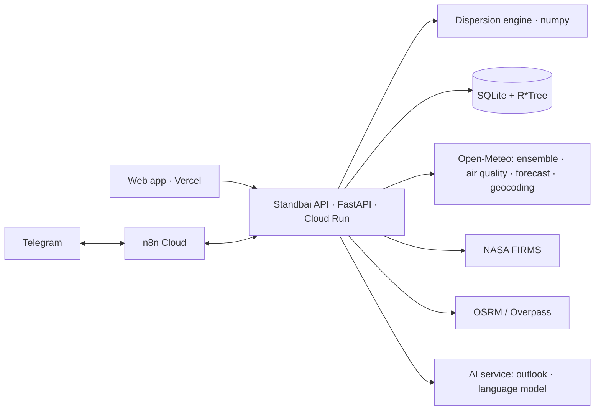

# Standbai: Backend API

**The engine and data behind Standbai**, a forecast-and-prepare platform for wildfire smoke and volcanic ash in Indonesia.

*ForgeHacks Online 2026 · AI + Climate track*

| | |
|---|---|
| Live API | *Cloud Run URL: added at submission* (OpenAPI docs at `/docs`) |
| Web app | [FE-FORGEHACK-2026](https://github.com/ITHACKITS/FE-FORGEHACK-2026) |
| AI service | [AI-FORGEHACK-2026](https://github.com/ITHACKITS/AI-FORGEHACK-2026) |

---

## The problem

Smoke from forest and peat fires and ash from eruptions reach millions of Indonesians every year, yet the warning signals are scattered:

- fire hotspots on satellite portals;
- volcano levels on the PVMBG site;
- air-quality readings elsewhere.

None of these say *whether smoke will reach a particular town, when, and what a family should prepare*.

## What this backend does

**1. Simulates where smoke and ash will go.**
- A Lagrangian particle model, run across a weather ensemble:
  - wind advection (RK2), turbulent diffusion, particle settling (Stokes with slip correction), and rain washout;
  - eruption source from column height (Mastin et al. 2009);
  - wildfire smoke from satellite fire radiative power.
- The ensemble gives **probability tiers** per hour (almost certain ≥90%, likely ≥50%, possible ≥5%), arrival times and severity percentiles.

**2. Measures impact as ranges.**
- People, children and elderly exposed; schools, health facilities and airports affected.
- Decision cards per facility; evacuation routes to safe hospitals (OSRM).
- All impact numbers are `{min, median, max}`.

**3. Answers residents city by city** (in progress):
- the air right now and a ±3-day PM2.5/PM10/dust series (CAMS forecasts);
- a 3-day / 2-week / 1-month outlook with the reasons behind it;
- a household preparedness kit.

**4. Pushes warnings** (in progress): scheduled jobs and a **Telegram bot** through n8n.
- `/subscribe <city>`, `/status <city>`;
- a daily digest;
- an instant alert when a city turns High.

**5. Stays honest.**
- Every assumption is listed with its source and status (`config/assumptions.yaml`).
- Hypothetical scenarios are labelled, and example data is flagged.
- Results carry the disclaimer: *not an official warning; follow BMKG, PVMBG and your local BPBD.*

## Status

The **Status** column is updated at submission time to what actually runs.

| Feature | Status |
|---|---|
| Simulation runs (volcano, fire), hourly probability tiers, impacts, decision cards | Working |
| Analysis: hotspot ranking, "extinguish a hotspot", carbon, rain effect, compare, sensitivity, severity, arrival | Working |
| Trust: validation, limits, sources, export, evacuation route, lahar warning | Working |
| Spatial DB: 70 volcanoes, 36 forest areas, 992 facilities, 4,248 hotspots (SQLite + R*Tree) | Working |
| Test suite | 40 tests passing (`pytest`, 2026-10-10) |
| City endpoints (`/cities`, `/area/*`), preparedness, fires, volcanoes | In progress |
| n8n jobs and Telegram bot | In progress |
| Cloud Run deployment | In progress |
| `/chat` orchestration, map frames, history + news | Planned |

## Architecture

| Folder | Contents |
|---|---|
| `app/api` | REST routers |
| `app/engine` | Particle engine, ensemble aggregation, land mask |
| `app/impact` | Exposure, advisory, routing, export, validation |
| `app/ingest` | Data clients (FIRMS, Open-Meteo, Overpass, population) |
| `app/db` | SQLite schema with R*Tree spatial indexes and repositories |
| `config` | Assumptions and hazard parameters, each with a source and status |
| `data` | Database, event presets, map layers |
| `docs` | Engine spec, API contract, data sources, datasets |
| `scripts` | Data generators, seeding, verification |
| `tests` | Physics, integrity, database and API tests |

## API overview

Full contract: [`docs/API_CONTRACT.md`](docs/API_CONTRACT.md) and the interactive docs at `/docs`.

| Group | Endpoints |
|---|---|
| Health and meta | `GET /health`, `/attributions`, `/limits`, `/sources` |
| Events | `GET /events`, `/events/{event_id}` |
| Simulation | `POST /simulate`; `GET /runs/{id}`, `/runs/{id}/tiers?t=`, `/impact`, `/location/{facility_id}`, `/facilities-impacted`, `/health-guidance` |
| Analysis | `GET /runs/{id}/ranking`, `/carbon`, `/land-water`, `/rain-effect`, `/advice`, `/severity`, `/arrival`; `POST /fire/extinguish`, `/runs/compare`, `/runs/sensitivity` |
| Trust | `GET /validation/{event_id}`, `/demo/play/{event_id}`, `/runs/{id}/export`, `/emergency-advisory`, `/evacuation-route`, `/lahar-warning` |
| Layers | `GET /layers/{name}` (facilities, hotspots, coastline, volcanoes, forests, summary KPI), `POST /layers/sync-live` |
| Planned (see `PRD.md`) | `/cities`, `/area/now`, `/area/series`, `/area/outlook`, `/preparedness`, `/fires`, `/volcanoes`, `/alerts/*`, `/jobs/*`, `/chat`, `/map/frames`, `/history/*` |

## Data

The main sources are NASA FIRMS, Open-Meteo (ensemble weather, CAMS air quality), PVMBG, OpenStreetMap, WorldPop and the ISPU thresholds. Licences and attribution are listed in [`docs/DATASETS.md`](docs/DATASETS.md), and the data model is in [`ERD.md`](ERD.md).

## Limitations

- **Weather ensembles:** for past events, individual ensemble members are no longer available. Those runs use synthetic members, and responses label them `members_source`.
- **Placeholder constants:** some constants are still `assumption_placeholder` (e.g. PM2.5 emission factors). Until they're sourced, engine-derived ISPU categories are switched off.
- **No eruption timing:** the engine simulates where ash would go; it doesn't predict *when* a volcano erupts.
- **Not an official warning.**

## Documentation

| File | Purpose |
|---|---|
| [`SETUP.md`](SETUP.md) | Install, run, test, deploy, n8n and Telegram |
| [`PRD.md`](PRD.md) | Requirements, API contracts and the task board |
| [`MEMORY.md`](MEMORY.md) | Context, conventions and decision log |
| [`AGENTS.md`](AGENTS.md) | Rules for coding agents and contributors |
| [`ERD.md`](ERD.md) | Database schema (current and planned) |
| [`docs/DATASETS.md`](docs/DATASETS.md) | Dataset catalogue with licences |
| [`docs/SPEC.md`](docs/SPEC.md) | Engine and data specification |
| [`docs/API_CONTRACT.md`](docs/API_CONTRACT.md) | Endpoint examples |
| [`docs/SOURCES.md`](docs/SOURCES.md) | Source verification log |

## Team

| Person | Role |
|---|---|
| Hikari Reiziq | Backend API and platform |
| Arya Bisma | Backend engine and data |
| Ziddan Habibie | Frontend |
| Arkan Zahir | AI |
