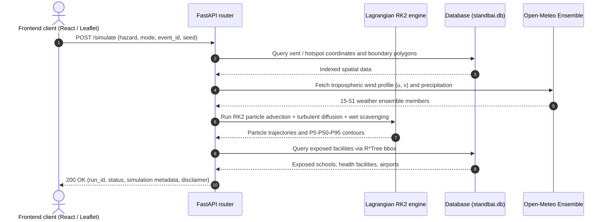

# StandbAI API Contract

The interface contract for the StandbAI backend.
- **Example responses:** taken from the test fixtures in `docs/fixtures/`.
- **Language:** example string values are shown in English, matching the English pass (`PRD.md`, BE-03). The fixture files still hold the earlier Indonesian strings until `scripts/generators/generate_fixtures.py` is re-run after that pass.
- **New endpoints:** city-centred endpoints, preparedness, alerts, jobs, chat and history are specified in [`../PRD.md`](../PRD.md) §4.5 and in the web app PRD §5. See section 4 below.

---

## 1. Overview and response standards

1. **Format:** JSON (REST), with GeoJSON for spatial layers (RFC 7946).
2. **Ranges (principle 1):** every population, facility and emission metric is a structured range:
   ```json
   { "min": 12000.0, "median": 45000.0, "max": 89000.0 }
   ```
   These are the P5, P50 and P95 uncertainty percentiles across the ensemble.
3. **Overrides rejected in auto mode:** `/simulate` rejects `auto` requests that carry `overrides` with **HTTP 422 Unprocessable Entity**.
4. **Disclaimer required:** every status, simulation and impact endpoint includes a `disclaimer` field.
5. **Assumption transparency:** every run returns the assumption parameters it used with their evidence status (`sourced`, `sourced_range`, `modeling_choice`, `to_verify`, `assumption_placeholder`).
6. **ISPU withheld without a valid emission factor:** while the PM2.5 emission factor (D13b) is a placeholder, `ispu.available` is `false` with a `reason`.

---

## 2. Endpoint summary (existing)

Status checked against the routers on `feat/be-implementation`, 2026-10-10: **31 routes are implemented**. In `/docs` (OpenAPI), the groups appear under the English tags `health`, `events`, `simulation`, `analysis` (formerly `lapis2`), `trust` (formerly "Lapis 3"), `layers` and `attributions`; the module files are still `app/api/lapis2.py` and `app/api/lapis3.py`. Rows marked **Not implemented** are documented here but aren't in the code.

| Category | Method | Endpoint | Description | Status |
|---|---|---|---|---|
| System | `GET` | `/health` | Service health, offline mode, source details | Implemented |
| System | `GET` | `/attributions` | Open-data attributions (PVMBG, BMKG, NASA, WorldPop, OSM) | Implemented |
| System | `GET` | `/limits` | Compute limits, spatial domain limits, assumption transparency | Implemented |
| System | `GET` | `/sources` | Verified open-data source catalogue and licence status | Implemented |
| Events | `GET` | `/events` | Ready-to-use events (volcanoes and forest areas) | Implemented |
| Events | `GET` | `/events/{event_id}` | Geographic metadata, elevation, coordinates and data status of an event | Implemented |
| Map layers | `GET` | `/layers/volcanoes-national` | 70 active PVMBG volcanoes (GeoJSON) | Implemented (via `/layers/{name}`) |
| Map layers | `GET` | `/layers/forests-national` | 36 forest and conservation areas (JSON) | Implemented (via `/layers/{name}`) |
| Map layers | `GET` | `/layers/facilities` | Public facilities (schools, health facilities, airports) in a bbox | Implemented |
| Map layers | `GET` | `/layers/hotspots?event_id={id}` | NASA FIRMS hotspot clusters (VIIRS and MODIS) | Implemented |
| Map layers | `GET` | `/layers/coastline` | High-resolution archipelago coastline (GeoJSON) | Implemented |
| Telemetry | `GET` | `/layers/summary-kpi` | National KPIs (volcanoes per level, total hotspots) | Implemented |
| Telemetry | `POST` | `/layers/sync-live` | Trigger a live sync of weather and hotspots from external APIs | Implemented |
| Simulation (L1) | `POST` | `/simulate` | Run the Lagrangian RK2 ensemble (auto / experiment) | Implemented |
| Simulation (L1) | `GET` | `/runs/{run_id}` | Status and metadata of a run | Implemented |
| Simulation (L1) | `GET` | `/runs/{run_id}/tiers?t={hour}` | GeoJSON tier polygons (max ≥5%, mid ≥50%, min ≥90%) for T+0…T+48 | Implemented |
| Simulation (L1) | `GET` | `/runs/{run_id}/particles` | Individual particle coordinates for inspection | **Not implemented** |
| Impact (L1) | `GET` | `/runs/{run_id}/impact` | Aggregate impact as `{min, median, max}` (people and facilities) | Implemented |
| Impact (L1) | `GET` | `/runs/{run_id}/facilities-impacted` | Exposed facilities with probability, ETA and recommendation | Implemented |
| Impact (L1) | `GET` | `/runs/{run_id}/location/{facility_id}` | Decision card for one facility | Implemented |
| Impact (L1) | `GET` | `/runs/{run_id}/district-summaries` | Impact per affected district | **Not implemented** |
| Analysis (L2) | `GET` | `/runs/{run_id}/ranking` | Fire clusters ranked by population-exposure risk | Implemented |
| Analysis (L2) | `POST` | `/fire/extinguish` | Counterfactual: extinguish selected hotspots | Implemented |
| Analysis (L2) | `GET` | `/runs/{run_id}/carbon` | CO2e emissions (peat vs non-peat) | Implemented |
| Analysis (L2) | `GET` | `/runs/{run_id}/land-water` | Volcanic ash impact on cropland and water | Implemented |
| Analysis (L2) | `GET` | `/runs/{run_id}/rain-effect` | Rain washout comparison | Implemented |
| Analysis (L2) | `POST` | `/runs/compare` | Two scenarios side by side | Implemented |
| Analysis (L2) | `POST` | `/runs/sensitivity` | Sensitivity sweep of a physical parameter (column height, rain) | Implemented |
| Analysis (L2) | `GET` | `/runs/{run_id}/advice` | Evidence-based early-action advice | Implemented |
| Analysis (L2) | `GET` | `/runs/{run_id}/severity?t={h}` | Severity percentiles of ash load or PM2.5 | Implemented |
| Analysis (L2) | `GET` | `/runs/{run_id}/arrival` | Time-of-arrival map per sector | Implemented |
| Trust (L3) | `GET` | `/validation/{event_id}` | Field validation (district hit rate, FSS, airport impact) | Implemented |
| Trust (L3) | `GET` | `/demo/play/{event_id}` | Keyframe playback for demos | Implemented |
| Trust (L3) | `GET` | `/runs/{run_id}/export?format={json\|html}` | One-page summary (structured JSON and printable HTML) | Implemented |
| Trust (L3) | `GET` | `/runs/{run_id}/lahar-warning` | Early warning for secondary rain-triggered lahars | Implemented |
| Public health (L3) | `GET` | `/runs/{run_id}/health-guidance` | Mask guidance (N95 vs surgical), contact-lens warning, vulnerable groups | Implemented |
| Preparedness (L3) | `GET` | `/runs/{run_id}/decision-matrix` | Trigger-action matrix and preparedness checklist | **Not implemented** |
| Preparedness (L3) | `GET` | `/runs/{run_id}/cross-border` | Transboundary haze tracking | **Not implemented** |
| Preparedness (L3) | `GET` | `/runs/{run_id}/evacuation-routes` | Safe evacuation routes and exclusion zones | **Not implemented** |
| Preparedness (L3) | `GET` | `/runs/{run_id}/evacuation-route` | Real road route (OSRM, OpenStreetMap) from a school or health facility to a safe hospital | Implemented |
| Preparedness (L3) | `GET` | `/runs/{run_id}/emergency-advisory` | Multi-sector emergency briefing (LLM + deterministic expert template: press release and public message) | Implemented |

---

## 3. Endpoint details and examples



### 3.1 Health check: `GET /health`
- **Purpose:** system readiness, operating mode (online/offline) and the disclaimer.
- **Example** (see `docs/fixtures/health.json`):
```json
{
  "status": "healthy",
  "version": "0.1.0",
  "disclaimer": "WARNING: StandbAI is preparedness software...",
  "offline_mode": false,
  "sources": {
    "openmeteo": "cached_offline",
    "firms": "cached_offline",
    "worldpop": "local_cog",
    "osm": "local_vector"
  }
}
```

---

### 3.2 Ensemble simulation: `POST /simulate`
- **Request body (auto mode):**
```json
{
  "hazard": "volcano",
  "mode": "auto",
  "source": { "event_id": "anak_krakatau_2026_09" },
  "horizon_hours": 6,
  "n_members": 5,
  "seed": 42
}
```
- **Mode rules:**
  - `auto`: uses reference or observed parameters unchanged. With `overrides`, the API rejects the request with HTTP 422.
  - `experiment`: allows `overrides` (e.g. `column_height_km`, `wind_direction_reverse`) and requires `scenario_label: "hypothetical scenario"`.
- **Example response** (see `docs/fixtures/simulate_volcano.json`):
```json
{
  "run_id": "sim_volcano_auto_...",
  "hazard": "volcano",
  "mode": "auto",
  "scenario_label": "standard analysis",
  "status": "completed",
  "progress_pct": 100.0,
  "members_source": "synthetic_spread",
  "n_members": 5,
  "horizon_hours": 6,
  "disclaimer": "WARNING: StandbAI...",
  "assumptions_used": [
    { "parameter": "mer_from_column_height", "status": "sourced", "source": "Mastin et al. 2009...", "caveat": null }
  ]
}
```

---

### 3.3 Three probability tiers: `GET /runs/{run_id}/tiers?t={hour}`
- **Query:** `t`, the forecast hour (0–48).
- **Format:** GeoJSON `FeatureCollection`.
- **Property:** three nested polygons, $Min (P \ge 0.90) \subseteq Mid (P \ge 0.50) \subseteq Max (P \ge 0.05)$.
- **Example** (see `docs/fixtures/tiers_t12.json`):
```json
{
  "type": "FeatureCollection",
  "features": [
    { "type": "Feature", "geometry": { "type": "Polygon", "coordinates": [...] },
      "properties": { "tier": "maximum", "threshold": 0.05, "probability_label": "P5 (low probability, farthest reach)", "hour": 6 } },
    { "type": "Feature", "geometry": { "type": "Polygon", "coordinates": [...] },
      "properties": { "tier": "median", "threshold": 0.5, "probability_label": "P50 (medium probability)", "hour": 6 } },
    { "type": "Feature", "geometry": { "type": "Polygon", "coordinates": [...] },
      "properties": { "tier": "minimum", "threshold": 0.9, "probability_label": "P90 (high probability, core area)", "hour": 6 } }
  ]
}
```

---

### 3.4 Population impact: `GET /runs/{run_id}/impact`
- **Example** (see `docs/fixtures/impact_volcano.json`):
```json
{
  "run_id": "sim_volcano_auto_...",
  "hazard": "volcano",
  "population_exposed": { "min": 2420.0, "median": 8650.0, "max": 18400.0 },
  "children_exposed": { "min": 605.0, "median": 2162.5, "max": 4600.0 },
  "elderly_exposed": { "min": 193.6, "median": 692.0, "max": 1472.0 },
  "area_exposed_km2": { "min": 120.5, "median": 340.2, "max": 680.8 },
  "schools_exposed": { "min": 2, "median": 5, "max": 12 },
  "healthcare_exposed": { "min": 0, "median": 2, "max": 4 },
  "ispu": { "available": false, "reason": "D13b PM2.5 emission factor is currently placeholder; ISPU category calculation withheld." },
  "disclaimer": "WARNING: StandbAI..."
}
```

---

### 3.5 Hotspot cluster ranking: `GET /runs/{run_id}/ranking`
- **Purpose:** order hotspot clusters by their smoke-exposure impact on settlements downwind.
- **Example** (see `docs/fixtures/ranking_fire.json`):
```json
{
  "run_id": "sim_fire_auto_...",
  "hazard": "fire",
  "cluster_count": 8,
  "ranked_clusters": [
    { "cluster_id": 1, "rank": 1, "center_lat": -2.341, "center_lon": 113.621, "hotspot_count": 42,
      "total_frp_mw": 1420.5, "peat_fraction": 0.85, "exposure_contribution_score": 88.4 }
  ]
}
```

---

### 3.6 Counterfactual extinguishing: `POST /fire/extinguish`
- **Request body:**
```json
{ "run_id": "sim_fire_auto_...", "extinguish_cluster_ids": [1] }
```
- **Example** (see `docs/fixtures/extinguish_fire.json`):
```json
{
  "original_run_id": "sim_fire_auto_...",
  "extinguished_clusters": [1],
  "population_reduced": { "min": 850.0, "median": 2840.0, "max": 6200.0 },
  "carbon_reduced_co2e_tonnes": { "min": 320.0, "median": 740.0, "max": 1150.0 },
  "reduction_percentage": 24.5
}
```

---

### 3.7 Carbon emissions: `GET /runs/{run_id}/carbon`
- **Basis:** Wooster et al. 2005 and Andreae & Merlet, with separate peat and non-peat emission coefficients.
- **Example** (see `docs/fixtures/carbon_fire.json`):
```json
{
  "run_id": "sim_fire_auto_...",
  "hazard": "fire",
  "total_co2e_tonnes": { "min": 1450.0, "median": 3120.0, "max": 5890.0 },
  "peat_emissions_tonnes": { "min": 1100.0, "median": 2400.0, "max": 4600.0 },
  "non_peat_emissions_tonnes": { "min": 350.0, "median": 720.0, "max": 1290.0 },
  "source": "Wooster et al. 2005; Li et al. 2018 (FRP to Dry Matter)"
}
```

---

### 3.8 Land and water impact: `GET /runs/{run_id}/land-water`
- **Purpose:** cropland under ash and affected water sources, with wet-ash and rain-lahar warnings.
- **Example** (see `docs/fixtures/land_water.json`):
```json
{
  "run_id": "sim_volcano_auto_...",
  "cropland_exposed_ha": { "min": 310.0, "median": 1050.0, "max": 2400.0 },
  "water_sources_exposed_count": { "min": 1, "median": 4, "max": 9 },
  "ash_wetness_warning": "WARNING: Ash deposits mixed with rain can double the load on roofs and can trigger secondary lahars in rivers.",
  "lahar_hazard_zones": ["Kali Gendol catchment", "Kali Woro catchment"]
}
```

---

### 3.9 Rain washout effect: `GET /runs/{run_id}/rain-effect`
- **Basis:** precipitation scavenging, $\Lambda = a \cdot R^b$.
- **Example** (see `docs/fixtures/rain_effect.json`):
```json
{
  "run_id": "sim_volcano_auto_...",
  "population_exposure_reduced": { "min": 450.0, "median": 1320.0, "max": 3100.0 },
  "area_footprint_reduced_km2": { "min": 18.0, "median": 45.0, "max": 92.0 },
  "hazard_specific_warning": "Rain cleans particles out of the air but turns them into ash mud on the ground."
}
```

---

### 3.10 Scenario comparison: `POST /runs/compare`
- **Request body:**
```json
{ "run_id_a": "sim_volcano_auto_...", "run_id_b": "sim_volcano_exp_..." }
```
- **Example** (see `docs/fixtures/compare_runs.json`):
```json
{
  "run_a": { "run_id": "sim_volcano_auto_...", "mode": "auto", "population_median": 8650.0 },
  "run_b": { "run_id": "sim_volcano_exp_...", "mode": "experiment", "population_median": 14200.0 },
  "deltas": { "population_delta_median": 5550.0, "area_delta_km2": 182.4 }
}
```

---

### 3.11 Parameter sensitivity: `POST /runs/sensitivity`
- **Request body:**
```json
{ "run_id": "sim_volcano_auto_...", "parameter_name": "column_height_km" }
```
- **Example** (see `docs/fixtures/sensitivity.json`):
```json
{
  "run_id": "sim_volcano_auto_...",
  "parameter": "column_height_km",
  "sensitivity_curve": [
    { "multiplier": 0.6, "value": 7.2, "population_exposed_median": 4100.0 },
    { "multiplier": 0.8, "value": 9.6, "population_exposed_median": 6200.0 },
    { "multiplier": 1.0, "value": 12.0, "population_exposed_median": 8650.0 },
    { "multiplier": 1.2, "value": 14.4, "population_exposed_median": 12800.0 },
    { "multiplier": 1.4, "value": 16.8, "population_exposed_median": 17900.0 }
  ]
}
```

---

### 3.12 Verified action advice: `GET /runs/{run_id}/advice`
- **Rule:** only advice sourced from official guidance is shown (e.g. D16, IVHHN or the Ministry of Health). Unvalidated advice is marked `available: false`.
- **Example** (see `docs/fixtures/advice.json`):
```json
{
  "run_id": "sim_volcano_auto_...",
  "sourced_advice": [
    { "action": "Wear a particulate respirator (N95 / FFP2) outdoors to prevent airway irritation from fine ash (<2.5 µm).",
      "source": "IVHHN (International Volcanic Health Hazard Network) / Indonesian Ministry of Health", "verified_on": "2026-10-05" },
    { "action": "Cover water tanks and storage tightly so they aren't contaminated by acidic volcanic dust.",
      "source": "BNPB volcanic eruption handling guidelines", "verified_on": "2026-10-05" }
  ],
  "additional_guidance": {
    "available": false,
    "reason": "Area-specific evacuation advice is withheld until instructions come from the PVMBG observation post or the local BPBD."
  }
}
```

---

### 3.13 Field validation: `GET /validation/{event_id}`
- **Purpose:** test the model against reported impacts and check the limits of comparison stations.
- **Volcano example** (see `docs/fixtures/validation_krakatau.json`):
```json
{
  "event_id": "anak_krakatau_2026_09",
  "hazard": "volcano",
  "resolution": "district",
  "validation_note": "Coarse validation at district level and for airport (aviation) impact.",
  "members_source": "synthetic_from_mean_spread",
  "reported_districts_evaluated": ["South Lampung Regency", "Tanggamus Regency", "Pandeglang Regency"],
  "district_hit_rate": 1.0,
  "fractions_skill_score": 0.74,
  "aviation_impact": {
    "airport_name": "Radin Inten II Airport (TKG)",
    "label": "aviation impact",
    "airspace_exposure_probability": 0.68,
    "dispersion_altitude_fl": "FL100 - FL250"
  },
  "grid_search_spread_inflation": [
    { "inflation_factor": 0.8, "fss": 0.68, "district_overlap_pct": 66.7 },
    { "inflation_factor": 1.0, "fss": 0.74, "district_overlap_pct": 100.0 },
    { "inflation_factor": 1.2, "fss": 0.75, "district_overlap_pct": 100.0 }
  ],
  "confidence_caveat": "Ensemble members are synthetic, built from the mean and spread..."
}
```
- **Fire example without stations** (see `docs/fixtures/validation_kalimantan.json`):
```json
{
  "event_id": "live_kalimantan",
  "hazard": "fire",
  "status": "not_testable",
  "reason": "No continuous air-quality stations (ISPU/OpenAQ) with matching history near the hotspot centre for this period.",
  "validation_note": "Without comparison stations the model makes no accuracy claim and is presented as a scenario dispersion simulation.",
  "accuracy_claim": "none"
}
```

---

### 3.14 System and domain limits: `GET /limits`
- **Example** (see `docs/fixtures/limits.json`):
```json
{
  "computational_limits": {
    "max_bbox_degrees": "6.0 x 6.0",
    "max_horizon_hours": 48,
    "max_ensemble_members": 100,
    "max_concurrent_runs": 2,
    "firms_rate_limit_per_10min": 5000,
    "firms_max_query_span_days": 5
  },
  "tier_thresholds": {
    "minimum": { "threshold": 0.90, "label": "P90 (high probability, core area)" },
    "median": { "threshold": 0.50, "label": "P50 (medium probability)" },
    "maximum": { "threshold": 0.05, "label": "P5 (low probability, farthest reach)" }
  },
  "assumptions_summary": {
    "total_assumptions": 10,
    "by_status": { "sourced": 1, "sourced_secondary": 1, "sourced_range": 1, "modeling_choice": 2, "to_verify": 1, "assumption_placeholder": 4 }
  }
}
```

---

### 3.15 Data source catalogue: `GET /sources`
- **Example** (see `docs/fixtures/sources.json`):
```json
{
  "title": "StandbAI data source catalogue",
  "verified_sources": [
    { "id": "D01", "name": "Open-Meteo Weather API", "status": "S", "license": "CC BY 4.0" },
    { "id": "D03", "name": "NASA FIRMS (MODIS & VIIRS)", "status": "S", "license": "NASA Open Data Policy" },
    { "id": "D09", "name": "WorldPop Population Density", "status": "S", "license": "CC BY 4.0" },
    { "id": "D18", "name": "OpenStreetMap / Overpass API", "status": "S", "license": "ODbL 1.0" },
    { "id": "D24", "name": "Mastin et al. 2009 (JVGR)", "status": "S", "license": "Scientific Publication" }
  ]
}
```

> The ids in this fixture don't match the dataset ids in `SPEC.md` (e.g. FIRMS is D09 there, WorldPop D18). Fix the fixture when it's regenerated.

---

### 3.16 Demo playback: `GET /demo/play/{event_id}`
- **Purpose:** precomputed timeline keyframes for a demo without waiting for computation.
- **Example** (see `docs/fixtures/demo_play.json`):
```json
{
  "event_id": "anak_krakatau_2026_09",
  "hazard": "volcano",
  "total_duration_hours": 48,
  "step_interval_hours": 6,
  "steps": [
    { "hour": 0, "time_label": "T + 00:00 h", "commentary": "Initial eruption phase..." },
    { "hour": 12, "time_label": "T + 12:00 h", "commentary": "The ash cloud has spread about 180 km..." }
  ]
}
```

---

### 3.17 One-page export: `GET /runs/{run_id}/export`
- **Query:** `format` (`json` or `html`).
- **HTML:** a standalone print-ready document (`@media print` styling) with impact range tables, D16 advice, an assumption transparency table and the disclaimer.
- **JSON** (see `docs/fixtures/export_summary.json`):
```json
{
  "run_id": "sim_volcano_auto_...",
  "hazard": "volcano",
  "mode": "auto",
  "impact": { "population_exposed": { "min": 2420.0, "median": 8650.0, "max": 18400.0 } },
  "advice": { "...": "..." },
  "assumptions_used": [ "..." ],
  "disclaimer": "WARNING: StandbAI..."
}
```

---

### 3.18 Rain-lahar warning: `GET /runs/{run_id}/lahar-warning`
- **Purpose:** the risk of secondary lahars from heavy rain on fresh pyroclastic ash.
- **Example** (see `docs/fixtures/lahar_warning.json`):
```json
{
  "run_id": "sim_volcano_auto_...",
  "hazard": "volcano",
  "lahar_risk_level": "advisory",
  "rainfall_threshold_trigger_mm_h": 20.0,
  "critical_ash_thickness_mm": 5.0,
  "vulnerable_drainage_basins": [
    { "river_name": "Way Sekampung catchment (Lampung)", "risk": "medium" },
    { "river_name": "Ci Asahan catchment (Banten)", "risk": "low" }
  ],
  "warning_text": "RAIN-LAHAR WARNING: rain above 20 mm/h..."
}
```

---

### 3.19 Real road evacuation route (OSRM): `GET /runs/{run_id}/evacuation-route`
- **Purpose:** a real, turning road route (not a straight line) from a school or health facility to the nearest safe referral hospital, using OSRM on OpenStreetMap.
- **Query:**
  - `from_lat` (float, required), `from_lon` (float, required);
  - `to_lat` (float, required), `to_lon` (float, required);
  - `from_name` (string, optional), `to_name` (string, optional).
- **Example:**
```json
{
  "status": "success",
  "from_name": "SDN 1 Sambirejo",
  "to_name": "RSUD Sleman",
  "distance_km": 21.4,
  "duration_minutes": 32.5,
  "mode": "osrm_real_road",
  "route_coordinates": [[-7.7812, 110.4912], [-7.7805, 110.4901], [-7.7782, 110.4850], [-7.6890, 110.3421]],
  "turn_by_turn": [
    { "instruction": "Start at SDN 1 Sambirejo towards Jl. Raya Prambanan", "distance_m": 450, "duration_s": 60 },
    { "instruction": "Turn right onto Jl. Magelang", "distance_m": 12400, "duration_s": 980 }
  ],
  "disclaimer": "This route is generated from the OpenStreetMap road network..."
}
```

---

### 3.20 Multi-sector emergency advisory: `GET /runs/{run_id}/emergency-advisory`
- **Purpose:** emergency-response protocol and public messages, generated automatically.
  - An LLM writes them when available. Per `PRD.md`, BE-04 routes this through the AI service: Featherless primary, Gemini fallback.
  - Otherwise a deterministic template based on emergency-operations practice is used: no emoji, no speculation.
- **Example** (abridged):
```json
{
  "run_id": "sim_volcano_auto_...",
  "alert_level": "EMERGENCY PREPAREDNESS",
  "badge_bg": "#dc2626",
  "scenario_label": "Mt. Anak Krakatau - Level III (Siaga / Watch)",
  "population_summary": {
    "total_median": 8650.0,
    "children_median": 1820.0,
    "elderly_median": 910.0,
    "priority_districts": ["Rajabasa District", "Kalianda District", "Bakauheni District"]
  },
  "llm_briefing": {
    "engine": "<provider and model that answered>",
    "status": "ai_generated",
    "press_release_title": "BPBD OPERATIONS CENTRE PRESS RELEASE: EARLY PREPAREDNESS WARNING FOR MT. ANAK KRAKATAU ERUPTION",
    "press_release_body": "The regional disaster management operations centre, together with the health office, issues an early preparedness warning following eruptive activity in the scenario Mt. Anak Krakatau - Level III (Siaga)...",
    "public_broadcast": "OFFICIAL NOTICE ... Protective actions: 1. Respiratory protection: wear an N95/KN95/KF94 particulate respirator with the nose clip sealed; cloth and surgical masks leak up to 50% at the sides. 2. Eye protection: do not wear contact lenses; sharp silica ash can scratch the cornea. Use sealed safety goggles. 3. Drinking water: cover tanks, storage and dug wells. 4. Indoors: close vents, put damp cloth in door and window gaps; don't sweep dry ash, spray lightly and mop. 5. Schools in affected areas switch to remote learning. Help: medical emergency 119; operations centre 112.",
    "key_callout": "Wear an N95 respirator, don't wear contact lenses, and protect your family's water."
  },
  "ppe_standards": {
    "mask_required": "N95 / KN95 / KF94 respirator (≥95% filtration of silica and PM2.5)",
    "mask_forbidden": "Cloth and surgical masks (30-50% side leakage, ineffective)",
    "eye_protection": "Sealed safety goggles with a rubber rim",
    "contact_lens_ban": "Don't wear contact lenses: sharp silica causes corneal abrasion"
  },
  "remote_learning_mandate": "Schools in areas with exposure probability ≥ 40% stop in-person classes and switch to remote learning",
  "water_security": "Cover drinking-water tanks and dug wells to keep out fluoride and sulphuric acid"
}
```

> **Today's behaviour:** the Gemini model ids in `app/impact/gemini_advisory.py` are retired, so the endpoint always returns the deterministic template (`gemini_briefing.status` is `"expert_fallback"`). `"ai_generated"` appears only after BE-04 routes the advisory through the AI service.
>
> The current code uses the keys `gemini_briefing` and `whatsapp_broadcast` (`app/impact/advisory.py`, `app/impact/gemini_advisory.py`). `llm_briefing` and `public_broadcast` above are the target names for BE-03/BE-04; keep the old keys until the frontend switches. The `remote_learning_mandate` field shown here is documentation only and isn't produced by the code on `main`.

---

## 4. Planned endpoints (see `../PRD.md`)

| Method | Path | Purpose | Priority |
|---|---|---|---|
| GET | `/cities` | The 29 cities used by the web app and the Telegram bot | P0 |
| GET | `/area/now?city=` | Current PM2.5, PM10, dust, ISPU category, advice, wind | P0 |
| GET | `/area/series?city=&from=-72&to=72` | 3-hourly series, recorded and forecast, plus daily peaks | P0 |
| GET | `/area/outlook?city=` | 3-day / 2-week / 1-month / nearest-volcano outlook with reasons and confidence | P0 |
| POST | `/preparedness` | Household kit quantities | P0 |
| GET | `/fires?hours=168` | FIRMS hotspots, last 7 days | P0 |
| GET | `/volcanoes` | Volcanoes with level and `hazard_radius_km` | P0 |
| POST/DELETE | `/alerts/subscriptions` | Telegram subscriptions (called by n8n, `X-Job-Token`) | P0 |
| GET | `/alerts/digest` | Daily digest messages per subscribed city | P0 |
| POST | `/jobs/refresh-fires`, `/jobs/refresh-air`, `/jobs/fetch-news` | Scheduled jobs for n8n | P0 / P1 |
| GET | `/events/timeline?days=7` | Notable fire clusters and eruptions | P1 |
| GET | `/map/frames/meta`, `/map/frames.bin` | PM2.5 grid frames for the web map | P1 |
| POST | `/chat` | Assistant for the web panel and Telegram | P1 (optional) |
| GET | `/history/events`, `/history/events/{id}`, `/history/events/{id}/news`, `/history/events/{id}/hotspots`, `/history/analogs` | Past events with news and lessons | P1 |
