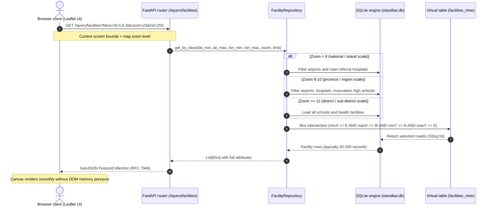
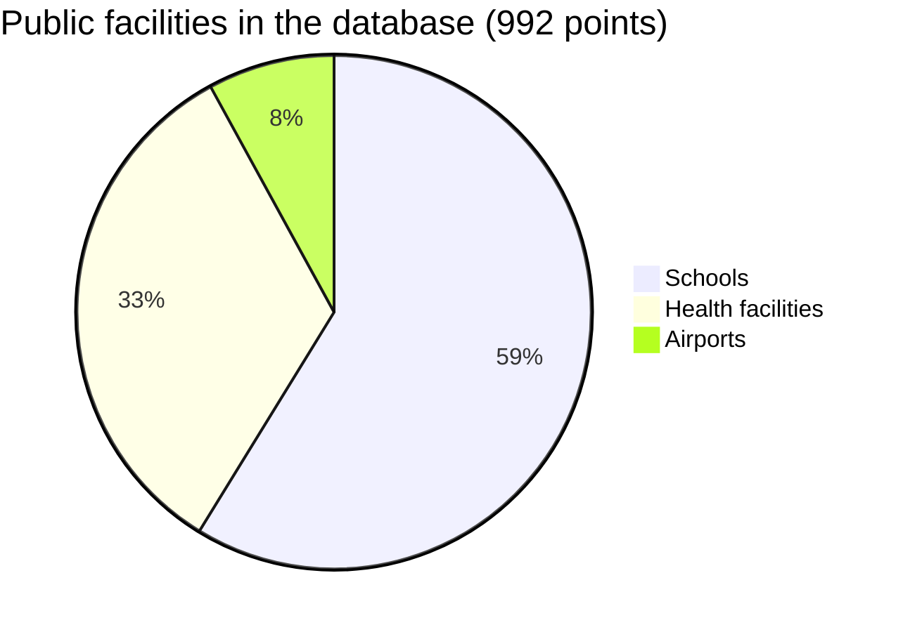

# Standbai Spatial Database Architecture

> **Superseded by [`../ERD.md`](../ERD.md).** `ERD.md` is the maintained data model: current tables, verified row counts, and planned tables. This document keeps the design rationale and the query flow. Counts below were corrected to the values read from the database on 2026-10-10.

This document covers the technical specification, relational schema, R*Tree spatial indexes and data-access (repository) pattern for the Standbai geographic information system and atmospheric dispersion simulator.

---

## 1. Summary and design rationale

Standbai integrates multi-hazard data at national scale across Indonesia's 38 provinces. To serve the interactive map without lag, the data layer moved from flat JSON files to a spatially indexed relational database.

| Criterion | Flat JSON files (legacy) | SQLite + R*Tree (chosen) | PostgreSQL + PostGIS (external server) |
| :--- | :--- | :--- | :--- |
| **Spatial search method** | Linear scan in memory, O(N) | R*Tree spatial query, O(log N) | GiST / R-tree index, O(log N) |
| **Bounding-box query latency** | > 150 ms | < 1 ms | 2–5 ms (TCP/IP overhead) |
| **Client RAM use** | All data loaded into the browser | Only features in the user's viewport | Only features in the user's viewport |
| **Operational independence** | Portable | Portable, zero configuration, no daemon | Needs an external service and authentication |
| **Offline mode** | Works | Works fully (`STANDBAI_OFFLINE=1`) | Fails if the local connection drops |

**Choice:** SQLite with its built-in C **R\*Tree virtual table module**. It gives fast memory-mapped reads, ACID transactions and fully self-contained execution with no external service.

---

## 2. Entity-relationship diagram

See [`../ERD.md`](../ERD.md) §1 for the maintained diagram. In short:
- **Base tables:** `volcanoes`, `forests`, `facilities` and `hotspots`, each indexed by an R*Tree virtual table.
- **Catalogue tables:** `events` and `simulation_runs`, unused today because events and runs live in files.

---

## 3. Viewport spatial query flow and level of detail (LOD)

When a user pans or zooms the interactive map, the system never requests every facility at once. Queries run dynamically:



---

## 4. Relational schema and spatial tables (DDL)

The connection uses production settings:
- **WAL mode:** `PRAGMA journal_mode = WAL;` (non-blocking reads during writes).
- **Normal sync:** `PRAGMA synchronous = NORMAL;`.
- **Cache:** `PRAGMA cache_size = -64000;` (64 MB page cache).
- **Relational integrity:** `PRAGMA foreign_keys = ON;` (no foreign keys are declared yet; see `ERD.md`).

### Main tables

```sql
-- National catalogue of 70 volcanoes
CREATE TABLE IF NOT EXISTS volcanoes (
    id TEXT PRIMARY KEY,
    name TEXT NOT NULL,
    province TEXT,
    region TEXT,
    elevation_m REAL,
    level INTEGER DEFAULT 1,
    level_name TEXT,
    color TEXT,
    radius_bahaya_km REAL DEFAULT 3.0,   -- hazard radius; English alias hazard_radius_km planned
    last_vona TEXT,
    latitude REAL NOT NULL,
    longitude REAL NOT NULL,
    has_event BOOLEAN DEFAULT 0,
    event_id TEXT,
    metadata_json TEXT
);

-- 36 forest and peatland areas
CREATE TABLE IF NOT EXISTS forests (
    id TEXT PRIMARY KEY,
    name TEXT NOT NULL,
    forest_type TEXT,
    province TEXT,
    region TEXT,
    latitude REAL NOT NULL,
    longitude REAL NOT NULL,
    area_ha REAL DEFAULT 0,
    risk_level TEXT,
    n_hotspots INTEGER DEFAULT 0,
    description TEXT,
    geometry_geojson TEXT
);

-- National public facilities (schools, health facilities, airports)
CREATE TABLE IF NOT EXISTS facilities (
    facility_id TEXT PRIMARY KEY,
    name TEXT NOT NULL,
    facility_type TEXT NOT NULL, -- 'school', 'healthcare', 'airport'
    latitude REAL NOT NULL,
    longitude REAL NOT NULL,
    district TEXT,
    province TEXT,
    metadata_json TEXT
);

-- NASA FIRMS satellite fire hotspots
CREATE TABLE IF NOT EXISTS hotspots (
    id INTEGER PRIMARY KEY AUTOINCREMENT,
    event_id TEXT NOT NULL,
    latitude REAL NOT NULL,
    longitude REAL NOT NULL,
    brightness REAL,
    confidence TEXT,
    frp REAL,
    acq_date TEXT
);
```

### R\*Tree spatial virtual tables

The SQLite R*Tree module indexes two-dimensional coordinates as minimum and maximum bounds:

```sql
CREATE VIRTUAL TABLE IF NOT EXISTS facilities_rtree USING rtree(
    id,          -- references facilities.rowid
    minX, maxX,  -- longitude
    minY, maxY   -- latitude
);

CREATE VIRTUAL TABLE IF NOT EXISTS volcanoes_rtree USING rtree(id, minX, maxX, minY, maxY);
CREATE VIRTUAL TABLE IF NOT EXISTS forests_rtree   USING rtree(id, minX, maxX, minY, maxY);
CREATE VIRTUAL TABLE IF NOT EXISTS hotspots_rtree  USING rtree(id, minX, maxX, minY, maxY);
```

### Synchronisation triggers

Triggers keep the base tables and their R*Tree indexes consistent without application code:

```sql
-- Facility insert
CREATE TRIGGER trg_facilities_insert AFTER INSERT ON facilities BEGIN
    INSERT INTO facilities_rtree(id, minX, maxX, minY, maxY)
    VALUES (new.rowid, new.longitude, new.longitude, new.latitude, new.latitude);
END;

-- Facility delete
CREATE TRIGGER trg_facilities_delete AFTER DELETE ON facilities BEGIN
    DELETE FROM facilities_rtree WHERE id = old.rowid;
END;

-- Facility coordinate update
CREATE TRIGGER trg_facilities_update AFTER UPDATE ON facilities BEGIN
    DELETE FROM facilities_rtree WHERE id = old.rowid;
    INSERT INTO facilities_rtree(id, minX, maxX, minY, maxY)
    VALUES (new.rowid, new.longitude, new.longitude, new.latitude, new.latitude);
END;
```

The same pattern exists for `volcanoes` and `forests`; `hotspots` has insert and delete triggers.

---

## 5. National data coverage

Verified counts in the database file on 2026-10-10:



1. **Active volcanoes: 70.** Source: PVMBG (Centre for Volcanology and Geological Hazard Mitigation), Geological Agency, Ministry of Energy and Mineral Resources. Covers type-A active volcanoes in Sumatra, Java, Bali, Nusa Tenggara, Sulawesi and Maluku.
2. **Forest and peatland areas: 36.** Stored with boundary polygons for point-in-polygon checks of hotspots (Shapely).
3. **Schools: 583.**
4. **Health facilities: 330** (hospitals and community health centres).
5. **Airports: 79**, from Sabang to Merauke.
6. **Satellite fire hotspots: 4,248**, from NASA FIRMS (VIIRS 375 m and MODIS), grouped by event preset.

> Earlier versions of this document said 2,039 facilities and 1,680 hotspots. Those numbers didn't match the database file and have been corrected. Facility source lists are described in [`DATASETS.md`](DATASETS.md).

---

## 6. Performance verification

`tests/test_database.py` checks the database layer: bounding-box queries, lookups by id, forest polygons and seeding.
- The full suite (`pytest -q`) reported **40 passed** on 2026-10-10.
- Spatial bounding-box queries typically complete in about a millisecond on a laptop. Treat this as indicative, not as a benchmark.
